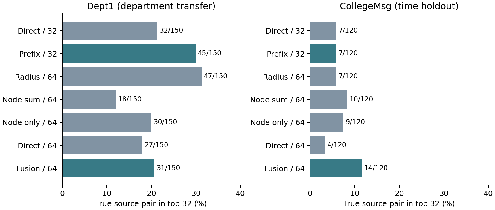

# 早期参与记录缺失下的双源识别：候选覆盖、正向评分与可恢复条件

> GNU libc、R 与 Samba 后续试验的汇总和文档入口见[实验进展与证据索引](experiments.md)。

## 摘要草稿

当群体形成的早期成员全部不可见时，历史接触能在多大程度上帮助定位最初两位参与者？本文在真实通信网络上模拟双源传播，只向预测模型提供窗口前的接触记录及遮挡后的成员加入批次。模型在历史名册中输出 12 人候选名单，并对所有合法无序二人组排名。我们在相同五帧观测和双源身份监督下，对照历史接触的表示、逐人或联合打分方式及名单解码。五个训练种子的结果表明，在 Enron 的 1,560 个普通事件上，静态无向历史与逐人打分的双源名单命中率为 7.01%，采用有方向和时间的历史特征后升至 9.47%；在后一组输入上增加双人交互、保持边际取人规则时为 8.78%。在 Dept2 的 1,200 个主测试事件上，相同条件下双人交互使真实源头对进入前 32 的比例从 9.50% 增至 13.63%。这说明历史接触表示能影响候选覆盖，而显式组合建模的收益随网络和评价目标变化。真值分层进一步表明，当其中一位源头没有直接带来新成员时，同时找回双源仍然困难。

在随后冻结的同机构跨部门检验中，模型仅用 Dept2 训练。在 Dept4 的 1,308 个合格模拟事件上，逐人时序模型、逐人静态模型和 FGSSI 的双源名单命中率分别为 23.49%、20.87% 和 17.87%。时序模型与 FGSSI 的配对差值为 +5.61 个百分点，按训练种子与时间窗分块重采样的 95% 区间为 [+4.44, +6.98]。两个开发网络上的特征消融显示，近期收发活动在本轮三个比较中带来的平均增益最大。

## 1　研究问题与文献位置

1. 两位源头是否都在可见后缀中留下了传播证据？若存在证据，候选检索还能遗漏多少例？
2. 在候选人和输出组合数相同的条件下，补全隐藏前缀能否改善真实源头对的名次？使用历史距离或源头节点得分能达到什么水平？
3. 当后期记录更少、距离发起时刻更远时，恢复难度如何变化？
4. 在相同五帧、身份监督和名单预算下，使用有向时序历史、加入双人交互及改变名单解码分别能带来多少收益？这些收益能否跨时间窗口、网络和训练种子保持？

Farajtabar 等从历史级联学习传播网络，再对不完整轨迹识别单源与起始时间。Zhu 等研究部分感染观测下的多源定位，并以覆盖半径评价候选集合。本研究采用首次加入的有序批次，遮掉整个早期前缀，源头数固定为二。距离对照取两位候选到可见成员的有向距离并计算覆盖半径，同时使用本研究的候选筛选与平分规则。这是对覆盖思想的任务适配，未完整复现 OJC 的子图提取，也未与文献的原始成绩直接比较。[Farajtabar 等，AISTATS 2015](https://proceedings.mlr.press/v38/farajtabar15.html)；[Zhu 等，Catch’Em All](https://arxiv.org/abs/1611.06963)

## 2　数据、真值与测试设计

CollegeMsg 是带方向和时间戳的高校社区私信网络。Dept3 和 Dept1 是同一研究机构的两个部门邮件子网，节点编号按各子网解释。源头身份与加入轨迹由模拟器生成。真实通信规定一次传播可能发生的时间与方向，原始文件没有联合发起者标签。[SNAP CollegeMsg](https://snap.stanford.edu/data/CollegeMsg.html)；[SNAP 部门邮件数据](https://snap.stanford.edu/data/email-Eu-core-temporal.html)

- **模拟与遮挡。** 每个窗口从此前出现过的成员中均匀抽取两人。已加入者向未加入者发送消息时，以 0.3 的概率触发加入；同秒接触使用更新前状态。源头始终隐藏，再隐藏不超过非源头成员数 50% 的最长完整批次前缀，至少隐藏一批、保留三人。推断使用窗口前的有向历史图、已知源头数和可见的相对加入批次。
- **两种评估人群。** 常规组为满足遮挡要求的事件。双源证据组另要求每位源头至少有一条实际触发路径到达可见成员，允许路径汇合。完整触发链只用于构造人群和审计。预测时无法直接判断一条真实记录属于哪一组。两组按各自的窗口配额抽取，存在重叠，结果分别报告。
- **训练与冻结。** 原节点模型使用 13 个历史活跃度和可见成员邻近度特征。训练组合模型时，先用较早窗口拟合节点和正向模型，在随后的训练窗口生成候选与正向得分。Dept3 有 304 个双源条件训练期滚动事件，其中 296 个真实组合在 64 人池内；CollegeMsg 相应为 240 个和 53 个。仅池内事件能提供真实对的排序标签。节点、正向和组合模型随后冻结，保留集不参与拟合或选参。[协议](../runs/thesis_holdout/protocol.json) · [训练窗口及参数](../runs/thesis_holdout/frozen.json) · [冻结指纹与版本](../runs/thesis_holdout/freeze_manifest.json)

| 测试用途 | 窗口与训练关系 | 有样本窗口 / 计划窗口 | 双源证据组 | 常规组 |
|---|---|---:|---:|---:|
| CollegeMsg 时间外测试 | 原始时长最后 20%，7 天一窗，训练来自同网络早期 | 5/5 | 120 | 100 |
| Dept3 原定时间外测试 | 原始时长最后 20%，14 天一窗 | 0/11 | 0 | 0 |
| Dept3 → Dept1 跨部门测试 | Dept3 权重直接迁移；Dept1 的 15%–80% 时段按序等距抽取 8 个完整双周窗口 | 6/8 | 150 | 72 |

CollegeMsg 每周目标为常规 20 例、双源 40 例，每周最多抽源 300,000 次。五周分别取得 40、40、22、12、6 个双源事件，测试总体率按事件计，样本较多的周权重较高。Dept3 最后 20% 的 11 个完整窗口均无接触，剩余不足 14 天的尾段有 117 条去重记录，按原协议舍弃。确认这一缺口后增加 Dept1 迁移实验，事先固定窗口选择规则、权重和配额。Dept1 每个有样本窗口保留 25 个双源事件和 12 个常规事件，另外两窗无接触。两个部门来自同一机构，这项迁移检验能支持的范围是部门间泛化。CollegeMsg 两组重叠 5 例，Dept1 重叠 17 例，共有 420 条不同事件记录。[迁移协议](../runs/thesis_holdout/transfer_protocol.json) · [各窗统计](../runs/thesis_holdout/summary.json)

## 3　评分方法与指标

每个事件先给所有合法历史成员打分，选出前 32 或 64 人，在其中枚举无序二元组合。32 人最多产生 496 对，64 人最多产生 2,016 对。节点求和直接相加两人的逆向分数。距离覆盖沿历史有向边从候选源头走向可见成员。对每位可见成员取两位候选到它的最短距离中的较小值，再取所有可见成员中该值的最大值作为半径。半径越小越靠前，半径相同优先取节点分数和较大的组合。

直接正向评分以候选源头为初始状态，计算依次观测到各批后缀成员的平均对数得分。正向模型使用均匀基底、接收活跃度、历史发送关系和近期发送关系。补前缀方法从训练期估计的隐藏人数分布抽样，以可见后缀引导隐藏成员抽取，校正提议概率后对 128 条可能历史求和。两种正向方法在相同 32 人名单上比较。模拟评分是对观测的模型近似。

64 人名单上，融合排序采用事件内标准化的三个特征，即较高节点分、较低节点分和直接后缀得分。给候选对的线性分数做 softmax，最小化真实对的负对数概率，附加 0.01 倍权重平方和。另训练去掉直接后缀得分的双特征模型作消融。所有方法最终返回前 32 对。**Hit@32 的分母是整组事件**；两位源头没有同时进入名单时记为失败。Top-1 衡量第一名是否精确命中。各组同时报告候选覆盖、逐窗结果和逐事件配对增减。

## 4　主结果

下表为主遮挡条件、双源证据组。每格依次给出“前 32 对命中数 / 第 1 对命中数”。两列分母分别是 120 和 150。32 人名单上的节点求和、半径覆盖是对预存 64 人排序限制到同一小名单后的补充对照。

| 组合排序 | 候选人数 | CollegeMsg 时间外 | Dept1 跨部门 |
|---|---:|---:|---:|
| 节点求和 | 32 | 10 / 1 | 19 / 1 |
| 距离覆盖 | 32 | 7 / 1 | 46 / 1 |
| 直接评分 | 32 | 7 / 1 | 32 / 2 |
| 补前缀，128 条路径 | 32 | 7 / 1 | 45 / 1 |
| 节点求和 | 64 | 10 / 1 | 18 / 1 |
| 距离覆盖 | 64 | 7 / 1 | 47 / 1 |
| 学习两项节点分 | 64 | 9 / 1 | 30 / 1 |
| 直接评分 | 64 | 4 / 1 | 27 / 2 |
| 学习两项节点分与直接得分 | 64 | 14 / 2 | 31 / 2 |

**候选覆盖。** CollegeMsg 在 32 人和 64 人预算下同时保留两位源头的事件分别为 29/120（24.2%）与 47/120（39.2%）；Dept1 分别为 85/150（56.7%）与 115/150（76.7%）。CollegeMsg 融合排序的 14 次命中对应入池后的 14/47（29.8%）和端到端的 14/120（11.7%）。两种分母回答不同的问题。

**隐藏前缀。** Dept1 的直接评分与补前缀分别命中 21.3% 和 30.0%。19 个事件因补前缀进入前 32，另有 6 个退出，净增 8.67 个百分点。以有样本窗口为单位、配对重采样 10,000 次，差值的描述性 95% 区间为 [+1.33, +14.00] 个百分点。相同 32 人名单的距离覆盖已命中 46 例，补前缀相较它多命中 15 例、失去 16 例。CollegeMsg 上两种正向评分命中了完全相同的 7 例。当前证据支持补前缀相对于直接评分的局部收益，模型优势随比较基线与网络变化。

**节点分与正向分的互补性。** CollegeMsg 的融合模型在相同 64 人名单上相较直接评分多命中 10 例、失去 0 例，差值为 +8.33 个百分点，按窗描述性区间为 [+5.10, +10.53]。相较仅含两项节点分的可训练模型，多命中 5 例、失去 0 例，区间为 [0.00, +9.82]。Dept1 上融合相较直接评分多命中 16 例、失去 12 例，净增 2.67 个百分点，区间为 [−2.00, +7.33]。每个网络只有 5 或 6 个有样本的现实窗口，区间反映已观测窗口间的差异。合并两网络给出一个总体提升会掩盖测试设计及结果的差别。



**常规人群。** CollegeMsg 常规组仅 2/100 例双源同入前 32 人，7/100 同入前 64 人，表中各方法在 100 例上均无前 32 对命中。Dept1 常规组对应覆盖为 15/72 和 23/72，直接评分与补前缀在 32 人池分别命中 6/72 和 8/72。筛选有双源传播证据的事件会改变任务难度。即便两人都有贡献，也可能由不同源头产生相同后缀；开发集里已有同一窗口、完全相同的四名可见成员对应两组不同真源的实例。[反例与事件编号](../runs/visible_dual_source/双源可见证据条件实验报告.md)

## 5　遮挡程度与固定观测人数

在每条主条件轨迹上分别遮挡 25%、50%、75%，只保留三档均满足最低后缀要求、两位源头均有后代到达各自后缀的同一批轨迹。表中每列分母固定，方法为冻结的 64 人融合排序。

| 网络 | 共同轨迹 | 三档可见人数中位数 | 三档双源入池数 | 三档前 32 对命中数 |
|---|---:|---|---|---|
| CollegeMsg | 45 | 10、7、4 | 20、21、18 | 5、5、5 |
| Dept1 | 99 | 19、13、7 | 77、73、70 | 24、17、11 |

Dept1 在共同轨迹上随遮挡加深而下降。为检查观测人数的影响，主结果完成后增加探索性对照：对同一条轨迹，取最早与最晚两个互不重叠、恰好各有三名新增成员的连续批次段，均跳过最初至少一批。沿用原冻结模型。Dept1 有 125 个可比较事件，早段命中 19、晚段命中 13；CollegeMsg 有 77 个，早、晚段各命中 5，但五个早段命中与五个晚段命中互不重合。再要求两位源头的传播链在早、晚两个三人段都可见，Dept1 为 9/30 与 4/30，CollegeMsg 为 3/18 与 1/18。固定人数后的变化表明，观测位置值得单独研究。该补充实验没有固定可见成员身份或网络距离，不能据此估计纯粹的时间因果效应。[配对观测结果](../runs/thesis_holdout/fixed_three_summary.json)

## 6　讨论与结论

**正向预测、隐藏成员恢复、双源识别是三个可分别测量的结果。** 在 Dept3 早期开发验证中，给定真实已加入集合，训练得到的正向模型对下一批成员的平均负对数评分为 3.780，同期均匀选择为 4.320；分数越低越好。另在真源已入池的 35 例上，把真实源头直接给模型，隐藏成员集合 F1 为 0.334，同输出人数的均匀随机期望为 0.088。这项诊断使用真源，不能作为端到端历史重建结果。最终测试中已有模型能生成部分合理前缀，却未形成跨网络一致的精确识别收益。[Dept3 正向与隐藏成员诊断](../runs/dept3_forward/隐藏前缀与正向评分实验报告.md)

**论文贡献适合落在评估设计和实证结论上。** 将“指定了两个人”与“两人的影响都到达观测”分别评估；将候选遗漏与组合误排分别计量；在同一名单上比较距离覆盖、直接正向与隐藏前缀。训练样本的条件匹配、扩大名单的成本和固定候选后的排序实验构成一条可复核的证据链。[候选训练与计算成本](../runs/conditional_candidates/候选筛选与预算实验.md)

**适用范围。** 本文验证了固定双源、重复接触激活、已知历史名册和首次加入后缀的模拟任务。未验证真实活动联合发起人身份、未知源头数、连续隐含路径的唯一性或任意传播机制下的识别能力。CollegeMsg 训练和测试共享一张网络及部分成员，Dept1 和 Dept3 共享机构来源；重复模拟增加的是给定现实窗口内的事件数。测试后如再调整候选或评分，应另取数据验证。当前结果足以撰写上述范围内的方法、实验与局限性。

## 7　补充实验：后期观测能把源头定位到多小的范围

我们进一步将输出改为一份固定 12 人的名单，评估两位模拟真源能否同时入选。双影响组要求两位源头的影响都到达后期观测。以 Dept2 较早窗口训练模型，在其较晚窗口的第三批模拟中，历史时序可达性、普通真源监督的逐人排序和以双源共同入选为目标的组合优化分别命中 51、119 和 128 个事件（共 320 个）。在同机构 Dept1 上原样迁移时，相应结果为 12、41 和 42 个（共 160 个）。这两张网络的大部分增益来自候选人的学习排序。组合优化在 Dept2 上额外命中 26 例、丢掉 17 例；在 Dept1 上额外命中 8 例、丢掉 7 例。

制造企业本域训练的组合优化在第三批只命中 10/320，历史时序可达性为 12/320。Dept2 模型迁移到 CollegeMsg 时组合优化命中 2/139，可达性为 4/139。点名任务也暴露出区别：Dept2 每次点一位能答对 66/320；即使只保留校准得分最高一成对应的阈值，测试也只有 16/37。制造企业分别为 25/320 和 2/26。现阶段可将研究结果写为后缀观测下双源候选范围的估计，以及同机构和异类网络之间的性能差异。单人高置信识别、真实发起人身份和跨网络稳定优势仍需额外证据。[完整实验与复现](../runs/partial_source_identification/部分源头识别与候选名单实验.md)

候选规模会显著改变对迁移结果的解读。同一个冻结的 Dept2 逐人排序模型，在 Dept1 和 CollegeMsg 固定保留 12 人时，双源覆盖分别为 41/160（25.6%）和 3/139（2.2%）。当每个事件都保留合法候选的 5%，两者分别为 48/160（30.0%）和 44/139（31.7%），平均名单为 15.2 人和 91.6 人。同预算下，历史时序可达性分别为 19/160 和 27/139。增加候选能找回排名居中的第二位源头，代价是更大的核查工作量。本文因而同时报告固定人数和固定比例，并单列不要求双源影响均可见的普通组。

## 8　沉默源头与固定预算的识别上限

在不要求两人影响均可见的普通事件中，我们区分“初始即在场”和“至少直接带来一位新成员”。在所模拟的制造企业、Dept2、Dept1、CollegeMsg 四组测试中，分别有 409/600、386/600、171/240、225/240 个事件仅一位源头发生过直接传播。以 Dept2 为例，原有组合模型在这 386 个事件的 12 人名单中保留传播者 320 次，保留沉默伙伴 27 次。按角色训练后分别为 253 和 30，增加伙伴召回的同时遗漏了更多传播者。

当完整加入时刻、成功父节点和当期全部接触都已知时，可以求出沉默伙伴的精确条件后验。若补入某候选作为第二源头，新增的外发尝试数为 H，被该初始身份阻断的入向尝试数为 B。在完整成功记录保持一致的条件下，候选的似然与 (1−p) 的 H−B 次幂成正比。均匀源头先验下，最可能的 11 个伙伴在上述四网的平均后验质量分别为 31.45%、17.03%、8.85%、0.85%。这些值描述本模拟器和已观测窗口中，仅一人直接传播时的最优条件覆盖。改变源头先验会改变该上限。

校准后组合旧模型与沉默伙伴模型，在第二批 1,680 个普通事件中，四网的双源命中数分别与旧模型持平。Dept2 的普通组逐人模型在固定 12 人下命中 88/600，对应的纯个人活跃度模型命中 5/600，说明在该网络后缀及图结构特征含有额外预测信息。现有结果支持分别报告活动源头定位、沉默源头可识别性及候选代价。[完整推导、逐窗结果与复现](../runs/ordinary_source_roles/沉默源头识别实验.md)

## 9　利用训练轨迹学习双源组合

上一节的条件后验也可以用来训练仅接收公开后缀的模型。当一位源头没有触发任何加入时，我们保留完整训练轨迹支持的全部伙伴，为每人分配相应的后验权重。候选编码器使用历史可达性、活动强度和后缀证据。组合分数同时考虑两人的单人分数、候选表示之间的相互作用、历史联系以及对可见成员的支持重叠。预测时在合法源头对上归一化，再选择内部组合概率之和较高的 12 人名单。

五张通信网络的普通事件主测试共 3,660 例。新模型与旧组合模型的双源名单命中数依次为 Dept2 的 213 与 193（共 1,200 例）、Dept1 的 45 与 32（480 例）、哥本哈根短信的 51 与 42（300 例）、制造企业的 30 与 34（1,200 例），以及 CollegeMsg 的 0 与 0（480 例）。Dept1 与短信网络直接使用冻结的 Dept2 权重。Dept1 四个现实窗口均有净增益；哥本哈根300例是同一现实窗口的两次模拟抽样。仅用实际抽中的一对源头训练同一组合模型，在 Dept2、Dept1、哥本哈根分别命中 208、44、51 例。组合建模在这三张网络的表现优于逐人排序，后验监督的额外贡献较小。

权重冻结后，在九个另外的晚期接触窗口对全部合法二人组计算精确排名。Dept2 的七窗共 1,050 例，新模型相较旧组合将真源对进前 32 的次数从 151 提高到 176，将第一名命中从 11 提高到 14。相同单人输入、相同后验监督下，仅用逐人分数得到 141 次前 32 命中与 3 次第一名命中。制造企业另两窗共 300 例，新旧模型均无第一名命中，前 32 分别命中 4 例与 3 例。这些结果支持在部分网络改善双源组合排序；跨网络稳定精确识别和沉默伙伴召回仍待解决。[完整实验、消融与复现](../runs/distilled_source_pairs/双源组合学习与预算实验.md) · [逐窗增益图](../runs/distilled_source_pairs/双源名单与逐窗增益.png)

## 10　同一后缀观测下的公开方法对照

在相同测试事件、合法名册及 12 人预算下，用公开实现重新训练 GCNSI，并以 OJC 的双中心距离准则对全部合法源头对评分。Dept2 四个主测试窗口中，组合模型同时找回双源 213/1,200 次，双中心覆盖为 163/1,200 次；逐事件配对后，前者独有 104 次，后者独有 54 次。另七个窗口分别为 210/1,050 和 162/1,050 次。真实源头对进入前 32 的次数在主窗从 96 提高到 160，在补充窗从 97 提高到 176。因而在这张网络上，名单覆盖与组合排名均有改善。

将后缀合为无序成员集合并重新训练同一组合模型，Dept2 主测试命中 181 次，Dept1 命中 30 次，低于保留批次后的 213 和 45 次。制造企业的无序版本为 31 次，有序版本为 30 次；CollegeMsg 两者均为零。哥本哈根短信上有序模型比双中心覆盖多命中六份名单，但真实对排第一为四次，低于双中心的六次。本文的证据支持部分接触网络上的候选名单和组合排序改善，精确判定两个源头及跨网稳定性仍受限制。公开方法均按本文的遮挡协议和输出预算做了适配。[公开基线、训练时长敏感性与顺序消融](../runs/matched_source_baselines/公开基线与后缀顺序消融.md)

以完整模拟轨迹事后划分，Dept2 主窗内两位源头均直接传播的 422 例中，有序模型比双中心多命中 56 例（167 对 111）；仅一位源头直接传播的 778 例中反而少命中 6 例（46 对 52）。在 Dept2 补充窗，两类分别净增 33 和 15 例。Dept1 的 13 例净增中有 12 例来自两位源头均直接传播的事件。普通事件上的整体收益因而不能直接解释成对沉默伙伴的恢复能力。

## 11　五帧时序对照与跨组织验证

为检验时序公开方法能否解释前述增益，将 FGSSI 适配为只读后期成员的五帧累积观测，并在原训练、验证事件上重新拟合。同时训练一个仅接收相同五帧及相同双源硬标签的组合模型。Dept2 主测试中，FGSSI、五帧组合和完整组合的 12 人双源名单分别命中 158、208 和 213 次（共 1,200 例）。五帧组合还保留了历史有向接触特征，并直接学习无序源头对的联合得分，因此该结果衡量两种方法整体的差异。[FGSSI 作者实现](https://github.com/cgao-comp/FGSSI) · [同观测与同监督对照](../runs/temporal_transfer/时序公开方法与独立网络验证.md)

首次在 Enron 上测试前冻结全部模型与评测规则。以 2001 年连续 26 个 14 天窗口产生 1,560 个普通事件。FGSSI、双中心、五帧硬标签组合和完整组合分别命中 80、104、143 和 137 例。完整组合相对 FGSSI 增加 3.65 个百分点，在 19 个窗口领先、4 个持平、3 个落后；按三个相邻窗口作循环块重采样，差值的 95% 百分位区间为 +2.44 至 +4.94 个百分点。完整组合相对 FGSSI 的净增 57 例中，51 例来自两位源头都直接传播的子组。真实对进入前 32 的次数分别为 FGSSI 的 43 次、双中心的 85 次、五帧组合的 95 次和完整组合的 83 次。独立测试支持后期观测下的候选名单改进，而完整后验监督相对硬标签的附加收益、沉默源头的恢复及精确点名能力仍有限。[协议锁](../runs/temporal_transfer/Enron/protocol_lock.json) · [逐窗配对结果](../runs/temporal_transfer/summary.json)

## 12　历史接触表示、组合打分和名单解码的受控比较

固定五帧后缀、两位源头身份硬标签及训练样本，从两个维度交叉构造四组模型。历史输入分别采用无向静态接触统计和有向时序接触特征；打分分别采用两人单人分数之和及带显式交互项的双人得分。先将各模型的候选对概率求出单人边际，再统一取前 12 人。Dept2 主测试中，静态加性、静态交互、时序加性、时序交互的五种子平均命中率依次为 12.85%、14.25%、15.73%、16.90%。Enron 相应为 7.01%、6.36%、9.47%、8.78%。制造企业主测试中，时序加性与时序交互依次为 2.52%、2.37%。这些结果将第 11 节的方法整体差距进一步限定到历史表示、组合打分和解码三个环节。

在 Enron，统一边际取人后，时序加性相对静态加性增加 2.46 个百分点。以训练种子和连续三个真实日历窗口同时重采样，95% 百分位区间为 [+1.28, +3.51]。给时序加性模型加入双人交互后，差值为 −0.69 个百分点，区间为 [−1.53, +0.17]。再将时序交互模型改用联合名单解码，平均命中率为 7.87%；FGSSI 为 6.27%。相同的时序加性模型比 FGSSI 高 3.21 个百分点。历史表示的差别包括方向、时间和随之构造的特征，本实验只能归因到这整套表示。Enron 四格比较是对已揭晓测试网络的后续分析。第 11 节的首次冻结结果按原配置保留。

若关注精确源头对的排名，Dept2 主窗中时序交互相对加性将前 32 命中率从 9.50% 提高至 13.63%，在七个补充窗口从 13.33% 提高至 16.95%。在 Enron，同一比较从 5.97% 变为 5.05%。因此显式组合建模的排序收益在 Dept2 的不同接触窗口重复出现，其跨组织推广具有条件。另在共同合格的 545 条 Dept2 新模拟轨迹上，将早期遮挡从约 50% 加深至约 75%，时序交互模型采用联合解码的名单命中率从 16.51% 降至 8.59%。制造企业的 1,312 条对应轨迹上从 2.53% 降至 1.17%。[四组消融、五种子与遮挡结果](../runs/factorial_history/四组消融与五种子验证.md) · [逐窗与逐种子统计](../runs/factorial_history/summary.json)

## 13　历史信息的分项检验与新部门的冻结验证

**开发网络。** 为定位第 12 节逐人模型的增益，保留相同的五帧观测、64 维输入、编码器、训练事件和验证损失，分别改变一组特征后重训。第一组将长期度数、总量与距离改按无向接触计算，两人间收发总量对称均分。第二组移除近期收发量、分时活跃度及与可见成员的近期联系。第三组移除按接触顺序回放得到的可达性、成员支持度及其事件级汇总。相应的候选人内排名特征同步替换或移除。每个变体在每个开发网络独立训练五次，按相同规则选轮次。各行均为后续四个时间窗中 1,200 个事件的双源名单命中率。

| 开发网络 | 完整逐人时序模型 | 长期联系改无向 | 移除近期收发活动 | 移除时序回放 |
|---|---:|---:|---:|---:|
| Dept2 | 15.73% | 15.82% | 14.25% | 15.42% |
| 制造企业 | 2.52% | 2.33% | 2.13% | 2.20% |

两个网络上，保留近期收发活动带来的平均差值分别为 +1.48 和 +0.38 个百分点。Dept2 有四个训练种子提高、一个持平，制造企业有四个提高、一个下降。保留时序回放在两网的平均差值均约 +0.32 个百分点。长期联系采用有向边的差值分别为 −0.08 和 +0.18 个百分点。近期活动和回放本身均使用发送方向，因此第一列消融只衡量长期静态联系中额外保留方向的作用。三项差值都是在其余输入保留时估计，不能相加归因。

**新部门的预先冻结检验。** 采用 SNAP 发布的欧洲研究机构 Dept4 内部邮件，以 Dept2 五个种子的既有模型做迁移。生成目标标签之前保存模型、特征尺度、主要代码、原始压缩包的 SHA-256 和评测协议。源模型、名单预算与比较方法在检验前已确定。沿记录跨度的 15% 至末尾等距取 12 个完整的 14 天窗口，每窗从历史名册均匀抽取两位源头 400 次。按普通事件规则模拟传播，遮住约前半段，要求可见后缀至少有三名成员。4,800 次抽取中，1,308 例合格，来自前七个所选窗口，后五个窗口为零。每例有 94 至 138 位合法候选人。预测只读取窗口开始前的历史和公开后缀，统计时再连接模拟真值。[SNAP 数据说明](https://snap.stanford.edu/data/email-Eu-core-temporal.html) · [冻结协议与文件指纹](../runs/history_components/Dept4/protocol_lock.json) · [逐窗抽样分母](../runs/history_components/Dept4/flow.json)

| Dept4 方法 | 12 人名单同时找回两位源头 | 12 人名单至少找回一位 | 五个训练种子的双源命中数，各自分母 1,308 |
|---|---:|---:|---|
| FGSSI 五帧适配 | 17.87% | 89.22% | 238、236、224、229、242 |
| 静态历史＋逐人打分 | 20.87% | 92.71% | 257、272、279、278、279 |
| 有向时序历史＋逐人打分 | 23.49% | 94.07% | 313、290、305、317、311 |

五个种子下时序模型均高于两种对照。按种子平均后，七个有合格事件的窗口也都观察到正差值。与 FGSSI 的差值为 +5.61 个百分点，95% 区间为 [+4.44, +6.98]。与采用相同逐人打分的静态模型相比，差值为 +2.61 个百分点，95% 区间为 [+1.66, +3.89]。区间在全部 12 个所选窗口上按相邻三个所选窗口成块，与训练种子同时配对重采样；10,000 次抽样中，9,967 次含合格事件并可计算命中率。结论适用于同机构新部门中满足观测条件的模拟传播。Dept4 比较完整历史表示，分项贡献来自开发网络。全部开发集完整模型的 12,000 份逐种子名单与上轮归档一致，4,800 次目标抽取的合格性和全部入选轨迹均已重放核对。[逐种子、逐窗结果和审计](../runs/history_components/summary.json)

从项目根目录执行以下命令可重建本节结果。训练输入和既有权重来自第 12 节，Dept4 原始压缩包与来源指纹见冻结协议。

```powershell
python -B scripts/history_components.py Dept2
python -B scripts/history_components.py company
python -B scripts/locked_dept4.py freeze
python -B scripts/locked_dept4.py generate
python -B scripts/locked_dept4.py predict
python -B scripts/report_history_components.py
```

## 14　候选人与后期可见成员的历史联系

独立成篇的[早期 Markdown 初稿](https://github.com/pbw1212/my_first-paper/blob/cd6b4e222703067b8d527a5cdc43c237cd96bfb4/%E8%AE%BA%E6%96%87%E5%88%9D%E7%A8%BF.md)将主结果组织为跨网络检验、同模型机制消融、传播规则敏感性及精确点名四部分。限制输入的两组模型在两个开发网络和五个种子下共新增 20 组训练权重，完整模型的 12,000 份开发测试名单与上轮归档逐例一致。加入四项候选人对可见成员的近期有向联系后，Dept2 的命中率由 1.28% 升至 14.68%，制造企业由 2.15% 变为 2.17%。Dept4 和 Enron 的本轮简化模型结果使用已揭晓测试网络，分别由 2.49% 升至 22.65% 和由 1.67% 升至 9.00%。这两组新增成绩属于事后迁移。对两个开发网络分开核对近 28 天的发送记录，同事件真实源头与其他候选人的联系次数平均 AUC 分别为 0.719 和 0.556。[方法图](../runs/recent_member_evidence/近期联系与传播条件.png) · [逐事件复核与诊断](../runs/recent_member_evidence/contact_diagnostic_and_audit.json)

传播规则实验两网共用 1,600 次独立源头抽取，每次在四种条件下模拟，合计 6,400 条条件轨迹，已全部复核。固定已有权重和回放参数，全部合格事件以及四条件共同合格的源头抽取分别统计。在每个网络、每种规则上，完整模型的五种子平均名单命中率均高于静态逐人和 FGSSI。两个网络各四个实际窗口，故该实验只作描述性条件比较。[Dept2 条件比较](../runs/recent_member_evidence/stress/Dept2/summary.json) · [制造企业条件比较](../runs/recent_member_evidence/stress/company/summary.json)

单快照实验直接使用固定提交中作者的候选对搜索函数，将候选空间、相似度与传播模拟适配到早期遮挡任务，使用 BoTorch 0.15.1 的 GP 接口和标量 RBF 核。每个网络 100 个事先按编号确定的开发测试事件，各执行 30,000 次基于过去接触的模拟，所有预测均返回不同的两个合法成员。两种方法的精确 Top-1 均为零。单快照学习模型的 Top-1 与既有全量排名逐例相符。排除共享窗口预处理和训练，搜索的事件内总耗时在 Dept2 约 173 秒、制造企业约 161 秒；单快照学习模型分别约 0.63 和 0.54 秒。两次进程并行，计时包括各自在线特征计算或图分解与搜索。部分 GP 优化收到收敛警告。[作者代码](https://github.com/XGraph-Team/BOSouL/tree/e891f84f8d5e1c829b511672da7d946aeba06def) · [Dept2 单快照协议](../runs/recent_member_evidence/single_snapshot/Dept2/protocol.json)

本节脚本从项目根目录运行，先执行同模型重训与冻结权重压力测试，再执行迁移、审计与制图。

```powershell
foreach ($network in 'Dept2','company') {
    python -B scripts/recent_member_evidence.py $network
    python -B scripts/contact_rule_stress.py $network
}
python -B scripts/transfer_recent_members.py
python -B scripts/check_recent_evidence.py
python -B scripts/plot_recent_members.py
```

要独立运行单快照适配，克隆上述作者仓库至本地，检出提交 `e891f84f8d5e1c829b511672da7d946aeba06def`。在能访问项目原有科学计算依赖的独立 Python 环境中安装 `botorch==0.15.1`，运行 `python -B scripts/masked_bosoul.py Dept2 <作者仓库路径>`，再将网络名改为 `company`。脚本校验作者源文件、冻结快照模型以及预选事件清单。

## 15　真实讨论的早期发言者验证

两个列表各取 2016 年 9 月至 2019 年 1 月的 29 份官方月归档，为 2017 至 2018 年的测试根邮件提供历史与 14 天随访。58 份文件共 23,206 条记录，解析得到 23,189 条具备身份、带时区的时间和消息编号的邮件头记录。历史联系以直接回复边表示，线程通过父消息编号追溯到根，主题文字仅用于排除疑似回复的伪根。地址按大小写归一并散列，输出只含去标识的消息、地址代号和统计值。Python-Dev 有 936 个可核对的根，174 条讨论在遮挡后合格；Python-Ideas 有 636 个可核对的根，243 条合格，两组合格讨论没有共享根消息编号。活动社区及成员存在潜在重叠，各列表的统计单独计算。[官方 Python-Dev 归档](https://mail.python.org/pipermail/python-dev/) · [官方 Python-Ideas 归档](https://mail.python.org/pipermail/python-ideas/) · [月度原始文件指纹与解析数](../runs/public_thread_transfer/archive.json)

主要比较固定 Dept2 的五个训练种子与名单预算，独立按每个根的最早不同作者及各成员首次出现时间复核标签和可见后缀。在全体合格讨论中，近期联系模型相对近 28 天发帖量的差值分别为 −8.51 和 −3.54 个百分点，两网配对区间均在零以下。按可打分样本和两名早期地址均合法的样本重复统计，后者每列表各 108 例。正文第 7 节保留了主要分母，并报告首发者与第二位发言者的单独成绩。两个角色是邮件头可核对的地址，原始归档缺失、孤立的回复和地址别名影响解释。[主要协议](../runs/public_thread_transfer/protocol.json) · [完整主要结果](../runs/public_thread_transfer/summary.json)

随后仅用前期真实讨论训练含两个或四个系数的模型，用不同的后续讨论检验发帖量基线。2019 年 2 至 4 月的 51 条合格讨论与前两年测试根无交集。模型训练于两个列表合并的 172 条双人可达记录，在 44 条后续可达记录中选正则强度；后续测试重新纳入名册外地址与观测不足的讨论。复核包含模型目标和梯度、小名单独立排序、先后两个时期的根编号、完整性及基线放宽可见人数门槛时的命中数。[后续归档清单](../runs/public_thread_transfer/calendar_followup/archives.json) · [参数锁](../runs/public_thread_transfer/calendar_followup/lock.json) · [逐月结果](../runs/public_thread_transfer/calendar_followup/summary.json) · [审计](../runs/public_thread_transfer/calendar_followup/audit.json)

```powershell
python -B scripts/public_thread_archive.py
python -B scripts/public_thread_transfer.py freeze
python -B scripts/public_thread_transfer.py python-dev
python -B scripts/public_thread_transfer.py python-ideas
python -B scripts/report_public_threads.py
python -B scripts/calendar_thread_calibration.py train
python -B scripts/calendar_thread_calibration.py test
python -B scripts/audit_calendar_threads.py
```

## 16　源头先验、沉默伙伴上限与新社区复核

有标签先验校准实验在 Dept2、制造企业、Dept4、Enron 各取 4、4、12、26 个原有测试窗。每窗每种源头规律独立抽取 160 次，22,080 次测试模拟得到 12,280 条合格事件。选规则时在两个开发网络各使用三个更早窗口，每窗每种规律抽 112 次；每网每种规律从合格事件中按窗口轮流取 32 条。在每个外部网络的所有测试窗口中沿用 Dept2 对应条件的规则。解析计算的候选边际与显式无序对矩阵最大绝对差为 $1.12\times10^{-16}$ 以下。所有校准和测试抽取均已重放，报告包含逐种子、逐窗口的配对增减及来源文件指纹。给测试名单打分时，已知抽取规律的结果是诊断对照。它与使用较早同条件标签选规则、以及完全不知道测试条件的设置分别报告。[抽样协议](../runs/source_prior_shift/protocol.json) · [逐条件成绩](../runs/source_prior_shift/results.json) · [审计](../runs/source_prior_shift/verification.json)

完整轨迹上限分析逐例核对可见批次和归档名单的命中判断，并使用完整父子记录推断必须出现的源头。两位源头均有直接传播时，完整记录能揭示两人；只出现一位时，用相应的源头先验重新加权所有相容伙伴。第 5.2 节的误差分解为对每条真实轨迹条件化的期望，和有限样本上的实际命中次数分别保存。[Dept2](../runs/source_prior_shift/Dept2/ceiling/summary.json) · [制造企业](../runs/source_prior_shift/company/ceiling/summary.json) · [Dept4](../runs/source_prior_shift/Dept4/ceiling/summary.json) · [Enron](../runs/source_prior_shift/Enron/ceiling/summary.json)

各网络另生成新的无标签校准批次与独立测试批次。三个可估计分量对应均匀抽取、仅一位偏向活跃者、两位都偏向活跃者。第四个压力条件按 $1+8\log(1+c_{ij}+c_{ji})$ 为无序候选对加权，$c$ 为前 28 天直接联系次数。它在拟合族之外。当期合格率诊断为每窗口、每分量额外模拟 512 次，精确条件轨迹诊断仅用校准批次的完整轨迹和相应先验比；同批测试事件始终只给模型可见后缀。全部 16,337 条测试事件经核验，明确检查校准编号与测试编号无交集，还独立优化混合目标并用显式成对矩阵复核每个有样本的窗口和条件的首个测试预测。[无标签协议](../runs/blind_source_prior/protocol.json) · [主比较](../runs/blind_source_prior/summary.json) · [Enron 权限条件诊断](../runs/blind_source_prior/Enron/privileged_diagnostic/summary.json)

真实讨论中的角色模型在读取 GCC 和 FFmpeg 测试归档前固定，采用两个角色各自的已知标签训练，避免仅保留双人可达样本。两个新社区各下载 29 份月归档，为 2021 至 2022 年测试提供历史和 14 天随访；共 44,448 条月归档消息记录。独立追溯了全部 56 条合格线程的首发和随后最早不同作者，复核可见人数、合法名单、发帖量排序与名单优化器的单点替换性质。名册扩展的后续事后核验覆盖四个真实列表，只使用指定截止时刻以前的记录；“真实根时间”对照使用预测时隐藏的信息。[角色训练和测试协议](../runs/historical_thread_roles/protocol.json) · [新社区结果](../runs/historical_thread_roles/summary.json) · [分层名册复核](../runs/real_roster_ceiling/summary.json)

```powershell
python -B scripts/source_prior_shift.py freeze
foreach ($network in 'Dept2','company') { python -B scripts/source_prior_shift.py cal $network }
foreach ($network in 'Dept2','company','Dept4','Enron') {
    python -B scripts/source_prior_shift.py test $network
    python -B scripts/prior_partner_ceiling.py $network
}
python -B scripts/report_source_prior_shift.py
python -B scripts/plot_prior_diagnostics.py
python -B scripts/blind_source_prior.py freeze
foreach ($network in 'Dept2','company','Dept4','Enron') {
    python -B scripts/blind_source_prior.py $network
    python -B scripts/diagnose_prior_evidence.py $network
}
python -B scripts/report_blind_prior.py
python -B scripts/historical_thread_roles.py freeze
foreach ($community in 'gcc','ffmpeg-devel') {
    python -B scripts/historical_thread_roles.py fetch $community
    python -B scripts/historical_thread_roles.py test $community
}
python -B scripts/report_historical_roles.py
python -B scripts/real_roster_ceiling.py
```

## 17　未知先验的名单保证与加入时刻上限

相对覆盖下界按模型给出的候选对质量计算。代码对两种目标使用相同的候选筛选、四个起点和单次换人规则。四网主结果保存每种生成条件的名单命中、逐种子差值、窗口分母及下界分位数；Dept4 和 Enron 另有配对分块区间。小图复核在 60 个十人名册上逐一检查所有五人名单，并对 43 组混合系数验证不等式。另在真实网络时间窗的 164 个“窗口×生成条件”组合重建显式候选对矩阵，最大下界计算差异低于 $2\times10^{-15}$。[逐条件结果](../runs/robust_source_list/summary.json) · [核验记录](../runs/robust_source_list/verification.json)

加入时刻上限使用“源头先验”实验的同一批模拟轨迹。无父节点解码器只接收窗口内接触、加入时刻及已知抽取规律。时间完整时，所有无观测父节点可解释的激活都强制源头覆盖至少一个可能的发送者。按最小的这类发送者集合求精确最优名单，再用上一实验的完整父节点后验评价其决策损失。另用逐批次独立似然实现、165 个小图分布及大候选集合的整数规划分支复核数值。[窗口和真值来源](../runs/activation_time_ceiling/protocol.json) · [似然与名单复核](../runs/activation_time_ceiling/verification.json)

```powershell
python -B scripts/robust_source_list.py freeze
python -B scripts/activation_time_ceiling.py freeze
foreach ($network in 'Dept2','company','Dept4','Enron') {
    python -B scripts/robust_source_list.py $network
    python -B scripts/activation_time_ceiling.py $network
}
python -B scripts/report_robust_source_list.py
python -B scripts/check_activation_time_ceiling.py
```

## 18　同预算混合抽取训练与真实迁移

以 Dept2 和制造企业为训练域，各自固定原训练、验证时间窗和每窗合格事件数。两网各训练四种模型，每种使用五个相同的随机种子。三种混合训练模型共享全部训练事件；四种模型共享混合验证事件。未向评测算法提供测试事件的实际生成分量。源头偏向对照仍在同一批时间窗进行，生成事件的随机流独立。第一项主比较是“在无序二人组损失中显式加入等权混合先验”与“混合样本直接训练”；两者的输出均按同一种边际概率规则选 12 人。简化方案“仅均匀样本训练、预测时校正”可衡量额外重训的价值。[40 个模型的协议](../runs/trained_source_mixtures/protocol.json) · [完整比较与逐窗分母](../runs/trained_source_mixtures/summary.json)

使用显式二人组矩阵独立检查不同先验下的损失值、损失对候选人得分的梯度和抽样窗口的测试预测。先生成两个训练域的全部权重，再运行四个测试域。真实邮件复核读取已有归档，采用 Dept2 的冻结权重，生成节点特征和先验权重时只用月初前历史。[模拟核验](../runs/trained_source_mixtures/verification.json) · [真实讨论复核](../runs/trained_source_mixtures/early_speakers/summary.json)

```powershell
python -B scripts/train_source_mixtures.py freeze
foreach ($network in 'Dept2','company') {
    python -B scripts/train_source_mixtures.py train $network
}
foreach ($network in 'Dept2','company','Dept4','Enron') {
    python -B scripts/train_source_mixtures.py test $network
}
python -B scripts/report_trained_mixtures.py
python -B scripts/real_trained_mixtures.py
```

## 复现与查表

在项目根目录、保留现有训练阶段制品的环境中，依次执行以下命令。冻结步骤只读早期训练数据和既有模型；生成步骤输出公开观测和单独的真值；预测步骤只读冻结参数、窗口前历史图和公开观测；最后才读取真值回放轨迹、核对候选合法性及完整排序。独立重跑在临时目录重建同一冻结流程，比较模型、协议、模拟样本和全部预测文件。

```powershell
python -B scripts/thesis_holdout.py freeze
python -B scripts/thesis_holdout.py generate
python -B scripts/thesis_holdout.py predict
python -B scripts/thesis_holdout.py external_generate
python -B scripts/thesis_holdout.py external_predict
python -B scripts/thesis_tables.py
python -B scripts/thesis_fixed_observation.py
python -B scripts/check_thesis_reproduction.py
```

汇总表包含逐窗分母、Top-1、Hit@32、平均倒数名次和配对差值。各网络的逐事件文件可追溯到同目录下的公开观测、完整真值、随机种子与候选排序。复核记录载有 40 个复现一致的文件指纹。新增 Dept1 原始压缩包的 SHA-256 和抽窗规则保存在迁移协议中。[主表与逐窗统计](../runs/thesis_holdout/summary.json) · CollegeMsg 逐事件结果（本地制品 `runs/thesis_holdout/CollegeMsg/event_results.jsonl`） · Dept1 逐事件结果（本地制品 `runs/thesis_holdout/Dept1/event_results.jsonl`） · [独立重跑核验](../runs/thesis_holdout/reproduction.json)
