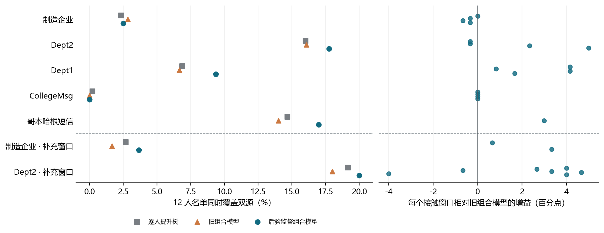

# 从后期观测直接学习双源组合

本轮预测目标为固定输出 12 位候选人，只有两位模拟发起人同时入选才记为一次命中。普通事件只需产生合格后缀，允许其中一位源头自始至终没有直接带来新成员。主实验的五张网络共 3,660 个事件，另在九个接触窗口复核 1,350 个事件。真实双源身份均由模拟器生成。

## 方法

**训练监督。** 对早期训练事件，使用完整加入时刻、当期接触与成功父节点计算源头对的条件分布。若两位源头都曾直接传播，两位身份已由成功父节点确定。若只有一位 a 直接传播，固定 a 后，合法伙伴 b 的权重为 (1−p) 的 H(b)−B(b) 次幂，再对所有合法伙伴归一化。H 是补入 b 后新增的外发尝试，B 是随之消失的入向尝试。该推导适用于本实验的均匀源头先验与独立接触激活机制。[后验推导与小图穷举](../ordinary_source_roles/沉默源头识别实验.md)

**预测模型。** 每位候选的输入包括窗口前的收发活动、历史传播可达性、与后缀成员的联系，以及这些特征在本事件候选人中的百分位。按可见成员的加入批次，检查较早的可见成员对较晚成员的历史可达性。对难由早先可见成员解释的位置赋予更高权重，提取每位候选的补充支持。共享的两层网络将候选编码成向量，产生单人分数 u。每组无序二人对 (i,j) 的分数为：

$$s_{ij}=u_i+u_j+z_i^T D z_j+w_1C_{ij}+w_2O_{ij}.$$

D 为含正负号的对角阵，z 为八维可学习表示。C 为两人以往双向接触强度，O 为两人对同一批可见成员的加权支持重叠，两个系数由本事件候选表示的平均值决定。分数交换 i、j 后不变。模型在全部合法无序源头对上归一化，每个事件权重相同。硬标签损失使用抽中的一对真源，后验监督损失为各合法真源对负对数概率按完整记录后验的加权平均。在生成假设正确时，后者是前者给定完整记录的条件期望。预测阶段只接收历史图和后缀。

**输出名单。** 先计算所有源头对的分数。保留边际概率前 48 人与得分前 48 对的全部成员，取其并集。在这个集合内用三种初值和单人替换搜索，使 12 人内部各对的概率之和尽可能大。这是近似求解。另保留按边际概率直接取前 12 人的结果。简单逐人模型只拟合 u，具有相同的单人输入与编码器。

**按预算训练的对照。** 对逐人模型再做一次单独实验：为每个候选给出可微的入选权重，使其和等于 12；最大化两位真源入选权重的乘积，同时以较小权重保留组合对数损失。验证允许选回微调前的模型。该近似使用连续权重，最终评估仍严格输出 12 个不同身份。

## 实验设计

制造企业与 Dept2 各用前 5 个训练窗的 1,000 个普通事件拟合，随后 3 窗共 300 个事件选训练轮次。同一张网络的逐人与组合、硬标签与后验监督四种模型使用相同样本、特征预处理、批次顺序及验证标准。主模型预先指定为后验监督的组合模型。Dept1、CollegeMsg 和哥本哈根短信均直接使用冻结的 Dept2 模型。各比较方法在逐事件相同的后缀、名单预算与真值上计分。

制造企业与 Dept2 的两批测试每批每窗 150 例，Dept1 与 CollegeMsg 每批每窗 60 例，均有 4 个现实测试窗。哥本哈根的公开短信记录覆盖四周，因此以前 14 天历史建立名册，在剩余时段产生两批各 150 个事件，共用一个现实窗口。原始表有 24,333 行，去掉同一时刻完全重复的有向边后为 24,312 条，涉及 568 个节点。只读取存档的边表。该网络在本轮权重冻结后引入。[原始研究](https://www.nature.com/articles/s41597-019-0325-x) · [数据发布页](https://figshare.com/articles/dataset/The_Copenhagen_Networks_Study_interaction_data/7267433) · [实际使用的边表存档](https://networks.skewed.de/net/copenhagen/files/sms.csv.zip)

## 五张网络的主测试

下表为两批合计的双源命中事件数。逐人树来自上一轮普通组训练，旧组合模型在双影响组上训练。神经逐人与神经组合模型均使用普通事件训练。

| 网络 | 事件数 | 逐人树 | 旧组合 | 逐人硬标签 | 逐人后验 | 组合硬标签 | **组合后验（主）** | 逐人后验按预算微调 |
|---|---:|---:|---:|---:|---:|---:|---:|---:|
| 制造企业 | 1,200 | 28 | 34 | 28 | 30 | 31 | **30** | 27 |
| Dept2 | 1,200 | 192 | 193 | 194 | 201 | 208 | **213** | 213 |
| Dept1 | 480 | 33 | 32 | 37 | 38 | 44 | **45** | 44 |
| CollegeMsg | 480 | 1 | 0 | 0 | 0 | 0 | **0** | 0 |
| 哥本哈根短信 | 300 | 44 | 42 | 46 | 45 | 51 | **51** | 47 |

在 Dept2，两批中主模型分别命中 108/600 和 105/600，旧组合为 101/600 和 92/600。合并两批，主模型单独命中 72 例，旧模型单独命中 52 例；四个窗口的净变化为 −1、−1、+7、+15。Dept1 两批为 23/240、22/240，对照为 17/240、15/240，四窗净变化为 +5、+1、+5、+2。哥本哈根两批为 30/150、21/150，对照为 26/150、16/150，两批不构成独立时间复现。

**收益来源。** Dept1 的组合硬标签模型已经达到 44/480，后验监督只再多命中 1 例。哥本哈根两个组合版本均为 51/300。Dept2 相应为 208/1,200 和 213/1,200。三张网络上组合得分都值得保留，但不能据此把全部增益归给后验监督。哥本哈根以相同后验分数直接取前 12 个边际概率还达到 53/300，局部集合优化也未在各网一致优于简单解码。

**失败情形。** 制造企业主模型相较旧组合在第一批从 10 提高到 13，第二批从 24 降到 17。CollegeMsg 有 465/480 个普通事件只有一位源头直接传播；全部事件中，主模型搜索前的候选并集仅在 6 例保留了两人，最终均未双源命中。扩大搜索次数本身不能找回已经落在并集之外的源头。预先设定的“两张开发网络各自两批均胜过两个旧基线”未达到。



## 换接触窗口与精确源头对排名

在看到主实验中两张开发网络表现不一致后，固定全部权重，取校准期结束后、未进入本轮训练/校准/主测试、历史名册内有至少 100 条当期接触的全部剩余完整窗口。制造企业有 2 窗，Dept2 有 7 窗；每窗重新产生 150 个普通事件。这一项改变了现实接触序列，并在解码前对全部合法源头对做精确排名。

| 网络 | 方法 | 双源均在 12 人内 | 真源对排第一 | 真源对进前 5 | 真源对进前 32 | 平均倒数排名 |
|---|---|---:|---:|---:|---:|---:|
| Dept2，1,050 例 | 旧组合 | 189 | 11 | 41 | 151 | 0.0309 |
| | 逐人后验 | 213 | 3 | 23 | 141 | 0.0210 |
| | 组合硬标签 | 209 | 15 | 44 | 174 | 0.0380 |
| | 组合后验 | 210 | 14 | 48 | 176 | 0.0384 |
| 制造企业，300 例 | 旧组合 | 5 | 0 | 0 | 3 | 0.0021 |
| | 逐人后验 | 12 | 0 | 0 | 7 | 0.0035 |
| | 组合硬标签 | 11 | 0 | 2 | 7 | 0.0042 |
| | 组合后验 | 11 | 0 | 1 | 4 | 0.0039 |

Dept2 七个补充窗口的双源名单净变化分别为 +6、+4、−1、+5、+7、−6、+6（相对旧组合）。组合后验比逐人后验少命中 3 份名单，却把真源对排进前 32 的次数从 141 提高到 176。这组结果支持把候选范围与组合排名列为两个指标。按预算微调的逐人硬标签模型在这些窗口命中 218 份名单，真实对进前 32 为 146 次。制造企业两窗虽均改善旧组合，绝对命中率仍低，所有受测方法均未把真实对排在首位。[Dept2 逐窗与排名](Dept2_new_windows/summary.json) · [制造企业逐窗与排名](company_new_windows/summary.json)

## 减少训练事件能否放大后验监督的收益

从每个早期训练窗口抽 50 个事件（共 250 个），以三组固定随机种子重复。每组内硬标签和后验监督共享训练子集、初始化和批次顺序，重新估计特征尺度，仍在 300 个验证事件上以真源对负对数概率选轮次。测量相同的 9 个补充窗口。

Dept2 三个子集的硬标签 / 后验监督双源命中分别为 199/199、183/170、194/199（每项分母均为 1,050）。制造企业为 14/14、10/12、12/14（分母 300）。Dept2 的后验监督只在第三个子集降低测试负对数损失，制造企业也是如此。现有证据不足以宣称这种监督稳定减少所需训练样本。[Dept2 小样本结果](Dept2_new_windows/small_sample_summary.json) · [制造企业小样本结果](company_new_windows/small_sample_summary.json)

## 复现与核验

模型、特征尺度与校准记录以 SHA-256 锁定。测试记录分别保存公开输入、模拟真值、逐事件名单与真源对对数损失。审计程序按原始接触及随机种子重放全部测试轨迹，核对遮挡、合法名册、12 人预算、配对增减及补充窗口时间边界。另用数值差分核对固定预算近似的梯度，用穷举次序核对并列时的真实对排名，并验证交换节点编号后组合模型的输出相应交换。[数值核验](numerical_checks.json)

在项目根目录、保留旧模型与原始数据时运行以下命令。短信存档位于 `data/raw/copenhagen-sms.csv.zip`，SHA-256 为 `9d51b590273320c42fd4d5d106e74e28e9f8d1254ba67c71131688bbb6435aa7`。

```powershell
foreach ($net in 'company','Dept2') {
    python scripts/distilled_source_pairs.py $net fit
    python scripts/budget_source_training.py $net
}
foreach ($net in 'company','Dept2','Dept1','CollegeMsg','CopenhagenSMS') {
    python scripts/distilled_source_pairs.py $net test
    python scripts/audit_distilled_pairs.py $net
}
foreach ($net in 'company','Dept2') {
    python scripts/distilled_source_pairs.py $net new_windows
    python scripts/audit_distilled_pairs.py "${net}_new_windows"
    python scripts/source_pair_label_efficiency.py $net
}
python scripts/audit_distilled_pairs.py checks
python scripts/plot_distilled_pairs.py
python scripts/audit_distilled_pairs.py paper
```
