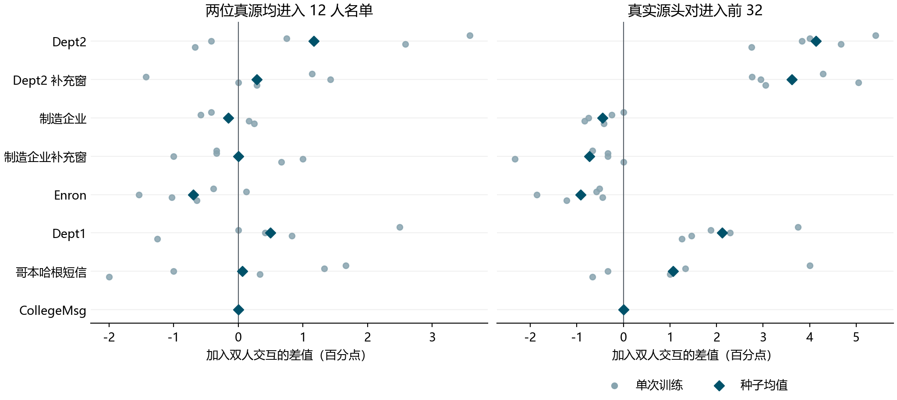

# 五帧双源定位中的历史表示、组合评分与解码

在相同五帧可见成员、真实双源硬标签、训练事件及预算下检验方法归因。每个开发网络使用 1,000 个较早事件训练、300 个后续事件按真实对负对数似然选轮次。随机种子为 111、314159、431、2027、9001，每格成对复用相同初始化种子、批次顺序和验证规则。Dept1、短信、CollegeMsg 与 Enron 使用 Dept2 模型。CollegeMsg 的本轮全候选诊断仅使用预先指定的种子 314159，其余组均使用五个种子。Enron 在上一轮已揭晓，本轮用于事后机制分析。真实网络记录提供接触时间与对象，传播及源头真值来自模拟。

静态历史对窗口前所有联系合并方向并累计次数，输入无向跳距倒数、联系强度、度及其与五帧成员的关系，同时保留帧的先后顺序。有向时序历史使用原组合模型的方向、近期接触、分时活动与历史传播可达性特征。两种历史各自计算候选对之间的联系和对可见成员的支持重叠。A、C 只相加两个人的单人分数，B、D 具有额外的低秩交互、两人联系方式与观测支持重叠项。各行内共享单人输入、编码器宽度、损失和选模规则；行间差值反映整套历史表示，包括特征构造和维数的变化。

## 相同名单解码下的四组比较

各格先用相同边际取人规则得到 12 人名单，表内为两位真源同时入选的百分比，跨种子取均值。末两列单位为百分点。

| 测试组 | 事件数 | A 静态加性 | B 静态交互 | C 时序加性 | D 时序交互 | B−A | D−C |
|---|---:|---:|---:|---:|---:|---:|---:|
| Dept2 | 1200 | 12.85 | 14.25 | 15.73 | 16.90 | +1.40 | +1.17 |
| 制造企业 | 1200 | 2.27 | 2.12 | 2.52 | 2.37 | -0.15 | -0.15 |
| Dept2 补充窗 | 1050 | 15.39 | 16.48 | 19.60 | 19.89 | +1.09 | +0.29 |
| 制造企业补充窗 | 300 | 3.60 | 3.07 | 3.80 | 3.80 | -0.53 | -0.00 |
| Enron | 1560 | 7.01 | 6.36 | 9.47 | 8.78 | -0.65 | -0.69 |
| Dept1 | 480 | 7.00 | 7.75 | 7.46 | 7.96 | +0.75 | +0.50 |
| 哥本哈根短信 | 300 | 14.07 | 14.60 | 14.60 | 14.67 | +0.53 | +0.07 |
| CollegeMsg | 480 | 0.00 | 0.00 | 0.00 | 0.00 | +0.00 | +0.00 |

Enron 上，固定逐人打分和名单规则后，有向时序历史相对静态历史提高 2.46 个百分点。固定有向时序历史后，加入双人交互的差值为 −0.69 个百分点。Dept2 上交互的名单收益为 1.17 个百分点，其更明显的收益体现在精确组合排名。



## 时间窗口、种子与精确组合排名

D−C 是固定名单解码后加上交互的收益。D 的解码增益是在同一分数矩阵上以联合名单搜索替换边际取人的差值。FGSSI 和联合解码 D 的主指标以跨种子的均值 ± 样本标准差表示，单种子只列点估计。正种子为 D−C 严格大于零的种子数。

| 测试组 | FGSSI 命中率 % | D 联合名单命中率 % | D 解码增益 pp | D−C 正种子 | C 精确 Top-32 % | D 精确 Top-32 % | C / D 的 MRR |
|---|---:|---:|---:|---:|---:|---:|---:|
| Dept2 | 11.67 ± 1.28 | 16.52 ± 0.90 | -0.38 | 3/5 | 9.50 | 13.63 | 0.0141 / 0.0240 |
| 制造企业 | 1.23 ± 0.48 | 2.55 ± 0.29 | +0.18 | 2/5 | 1.18 | 0.73 | 0.0037 / 0.0029 |
| Dept2 补充窗 | 13.26 ± 0.80 | 20.10 ± 0.39 | +0.21 | 3/5 | 13.33 | 16.95 | 0.0233 / 0.0355 |
| 制造企业补充窗 | 1.87 ± 0.69 | 3.93 ± 0.43 | +0.13 | 2/5 | 2.53 | 1.80 | 0.0038 / 0.0036 |
| Enron | 6.27 ± 0.80 | 7.87 ± 0.76 | -0.91 | 1/5 | 5.97 | 5.05 | 0.0128 / 0.0115 |
| Dept1 | 5.96 ± 0.56 | 7.92 ± 1.54 | -0.04 | 3/5 | 5.13 | 7.25 | 0.0100 / 0.0155 |
| 哥本哈根短信 | 17.27 ± 1.21 | 14.80 ± 1.61 | +0.13 | 3/5 | 11.53 | 12.60 | 0.0258 / 0.0312 |
| CollegeMsg | 0.00 | 0.00 | +0.00 | 0/1 | 0.00 | 0.00 | 0.0001 / 0.0000 |

Enron 的配对区间同时重采样五个训练种子及连续三个日历窗口，循环块抽样 10,000 次。对比仅适用于这批组织内接触与模拟事件。

| Enron 配对比较 | 平均差值 pp | 95% 百分位区间 pp |
|---|---:|---:|
| B-A | -0.65 | [-1.54, +0.14] |
| D-C | -0.69 | [-1.53, +0.17] |
| C-A | +2.46 | [+1.28, +3.51] |
| D-B | +2.42 | [+1.18, +3.64] |
| Ddecode | -0.91 | [-2.01, +0.08] |
| D-F | +1.60 | [+0.19, +2.95] |
| C-F | +3.21 | [+1.95, +4.42] |

## 名单预算、沉默源头与遮挡

以下分别列 D 在预算 8、12、20 时联合名单命中率，以及预算 12 时按真值事后分层的命中率。各格单位为 %。

| 测试组 | 8 人 | 12 人 | 20 人 | 单直接传播源 | 双直接传播源 |
|---|---:|---:|---:|---:|---:|
| Dept2 | 9.13 | 16.52 | 31.02 | 5.84 | 36.21 |
| 制造企业 | 1.07 | 2.55 | 7.13 | 1.12 | 5.68 |
| Dept2 补充窗 | 11.45 | 20.10 | 35.60 | 8.46 | 39.54 |
| 制造企业补充窗 | 1.53 | 3.93 | 11.93 | 1.58 | 8.00 |
| Enron | 4.26 | 7.87 | 15.40 | 3.08 | 19.65 |
| Dept1 | 4.62 | 7.92 | 15.71 | 2.41 | 18.42 |
| 哥本哈根短信 | 10.47 | 14.80 | 19.73 | 0.87 | 20.96 |
| CollegeMsg | 0.00 | 0.00 | 0.00 | 0.00 | 0.00 |

CollegeMsg 的 480 例中，D 的 12 人名单至少找回一位源头 52 次；前 48 边际候选及前 48 对端点的并集同时保留两位源头 6 次，最终名单同时找回两人 0 次。

开发网络四个主窗各作 400 次新的均匀双源抽取。固定模型，用同一潜在轨迹生成 50% 和 75% 两种遮挡；同批成员不可拆分，后缀至少需有三位成员。表内列出抽取分母及合格数，再列仅取两种遮挡均合格事件时的配对结果。FGSSI 与 D 均按预算 12 评分。

| 开发网络 | 总抽取 | 50% 合格 | 75% 合格 | 共同合格 | 全部合格 D 50% / 75% | 配对 D 50% / 75% | 配对 FGSSI 50% / 75% |
|---|---:|---:|---:|---:|---:|---:|---:|
| Dept2 | 1600 | 696 | 547 | 545 | 15.17% / 8.92% | 16.51% / 8.59% | 12.59% / 7.45% |
| 制造企业 | 1600 | 1320 | 1312 | 1312 | 2.52% / 1.17% | 2.53% / 1.17% | 1.27% / 0.75% |

## 运行与核验

每个开发网络每个历史表示的 scale.npz 仅从训练事件估计。模型选择记录保存轮次、验证损失、权重指纹和参数量；训练耗时与推理、解码时间为并发运行条件下的观察值。每个队列的 cells.jsonl.gz、fgssi.jsonl.gz 按事件与种子保存名单成员、命中、候选池保留及精确名次。运行前后可核对已有 314159 双人模型与 111 FGSSI 的归档名单及排名。

[全部分组与配对增减](summary.json) · [归档重放与结果指纹](audit.json) · [训练脚本](../../scripts/factorial_history.py) · [FGSSI 重复训练](../../scripts/factorial_fgssi.py) · [预算与遮挡评测](../../scripts/evaluate_factorial_history.py) · [审计脚本](../../scripts/summarize_factorial_history.py)

与归档逐例复核的 12 人名单全部一致。共有 17 个精确名次发生变化，其中 0 个跨过 Top-1、5 或 32 的报告阈值。抽取四例复算，改变浮点推理的线程与批次设置可重现名次差异。另有 2 条新遮挡观测在静态交互打分中出现约 2.4×10⁻⁷ 的矩阵不对称，解码时以无序候选对使用的上三角分数恢复对称。逐例记录见分组汇总。[精确排名复算](rank_precision_check.json)

以下复现命令从项目根目录运行。归档的 111 FGSSI、314159 五帧交互模型和原始公开事件属于输入。

```powershell
foreach ($network in 'Dept2','company') {
    python -B scripts/factorial_fgssi.py $network 111 314159 431 2027 9001
    foreach ($representation in 'static','temporal') { python -B scripts/factorial_history.py $network $representation }
    python -B scripts/evaluate_factorial_history.py ("{0}_masks" -f $network) generate
}
foreach ($cohort in 'Dept2','company','Dept2_new_windows','company_new_windows','Dept1','CopenhagenSMS','CollegeMsg','Enron','Dept2_masks','company_masks') {
    foreach ($model in 'cells','fgssi') { python -B scripts/evaluate_factorial_history.py $cohort $model }
}
python -B scripts/summarize_factorial_history.py
python -B scripts/report_factorial_history.py
python -B scripts/check_factorial_precision.py
python -B scripts/plot_factorial_history.py
```
