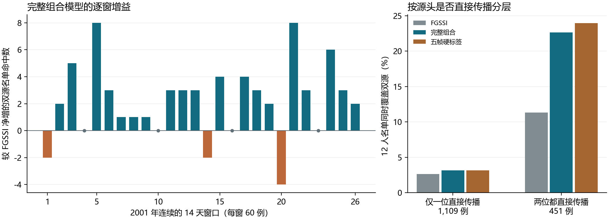

# 时序公开方法与 Enron 独立网络验证

本实验检验两个问题。第一，当对照方法也使用后期成员出现的顺序时，双源组合模型能多找回多少对源头？第二，在开发阶段未使用的组织中，这一差距是否还能重复？每个事件统一从尚未出现在公开后缀中的历史成员中选 12 人。两位模拟源头必须同时入选才算名单命中。组合精确排名另在全部合法无序二人组上计算，分母始终包含沉默源头事件。

## 公开方法与公平性控制

**FGSSI 时序基线。** 使用 Hou 等人在 2025 年发表的 FGSSI 及其公开代码。将同一份有序后缀转换为五帧累积可见成员集合，覆盖首批到末批，在批次下标上等距取整；短后缀允许重复帧。输入的零表示该人在该帧尚未被观测，可能属于隐藏前缀。每个窗口从窗口开始前的接触构建无向图，依作者示例计算两类成员状态、两类相对邻居比例、度、特征向量中心性和两类按最大度归一化的邻居数量。预测时，全部方法均无权观察窗口内的真实接触或隐藏成员。[作者论文](https://doi.org/10.1109/TDSC.2025.3545270) · [作者代码与版本](https://github.com/cgao-comp/FGSSI/tree/cb3cbaf3a14fe5fa9cd488ffce203c674eb42edc)

沿用作者的五个图卷积编码器、三层双向 GRU、四头时间注意力、分组学习率和 20 轮训练预算。在本任务中用相同前向过程训练与推理；把作者的加权分类与辅助平方损失作用于合法节点，按每个事件的合法人数重算类权重。输出节点源头对数优势，取前 12 人，同时用两人对数优势之和给组合排名。每个开发网络独立使用与原模型相同的 1,000 个训练事件和 300 个较晚验证事件；在第 5、10、20 轮按验证集真实源头对负对数似然选权重。只采用一个训练种子。向量化实现用同一组参数与作者图卷积、GRU 和注意力的逐项调用核对了小图输出概率和参数梯度。这是对隐藏后缀与固定名单任务的适配复现。

**五帧硬标签组合对照。** 从 FGSSI 的同五帧中取相邻帧新增的成员，每组按编号排序，去掉没有新增成员的重复帧。组合模型仅用抽取的两个真实源头作为硬标签，从头训练。它与 FGSSI 的可见后缀信息、训练样本和身份监督一致；其历史接触特征仍利用方向和时间，打分与解码也不同。完整组合模型额外使用原始批次粒度和训练期完整轨迹提供的后验监督。比较两个组合版本时，这两项因素同时改变，各自的贡献可结合此前单因素消融判断。[历史顺序与监督消融](../matched_source_baselines/公开基线与后缀顺序消融.md)

## 独立网络与冻结规则

Enron 邮件是此前未用于开发或验证的组织。原始发布将每次接触表示为时间、发件人和收件人。使用 igraphdata 锁定版本的有向网络，按 UTC 读取发送时刻，以匿名节点编号建图。125,409 条记录中，排除 1998 年前记录 174 条、剩余记录中的自发邮件 16,410 条，合并同秒同向重复记录 74,398 条，得到 34,427 条接触、182 个不同节点。数据只提供接触，论文中的传播和源头真值由与旧实验相同的模拟器生成。[数据发布说明](https://www.cis.jhu.edu/~parky/Enron/) · [igraphdata 固定版本](https://github.com/igraph/igraphdata/tree/d61dabac88607cf726323dcc68109fb5753aebc7) · [清洗计数与原文件指纹](Enron/provenance.json)

在生成 Enron 测试事件前，对 Dept2 模型参数、对照配置、数据文件及评测代码计算 SHA-256 并冻结。以 2001 年 1 月 1 日为起点，顺序取全年 26 个完整且互不重叠的 14 天窗口；每窗用不同的固定种子，取前 60 个合格普通事件，不按传播源头数、网络活跃度或模型表现筛窗。每例的候选与模型输入只使用当窗之前形成的名册、历史接触及已公开后缀。保留相邻窗口共享部分历史、同窗模拟共享接触序列的依赖结构。区间以连续三个日历窗为块做循环块自助法，重复 20,000 次，解释范围限于该组织和这段时期。[外部协议及权重锁](Enron/protocol_lock.json) · [逐窗采样](Enron/generation.json)

## 实验结果

下表为各方法同时找回双源的事件数。差值按完整组合与 FGSSI 在同一批事件上的命中率计算。

| 网络 | 事件数 | FGSSI | 双中心 | 五帧硬标签组合 | 全批次硬标签组合 | 完整组合 | 差值（百分点） |
|---|---:|---:|---:|---:|---:|---:|---:|
| 制造企业 | 1,200 | 16 | 16 | 32 | 31 | 30 | +1.17 |
| Dept2 | 1,200 | 158 | 163 | 208 | 208 | 213 | +4.58 |
| Dept1 | 480 | 32 | 32 | 44 | 44 | 45 | +2.71 |
| CollegeMsg | 480 | 0 | 0 | 0 | 0 | 0 | 0.00 |
| 哥本哈根短信 | 300 | 46 | 45 | 51 | 51 | 51 | +1.67 |
| 制造企业补充窗 | 300 | 4 | 5 | 12 | 11 | 11 | +2.33 |
| Dept2 补充窗 | 1,050 | 145 | 162 | 209 | 209 | 210 | +6.19 |
| Enron 独立测试 | 1,560 | 80 | 104 | 143 | 145 | 137 | +3.65 |

Dept2 四个主窗中，完整组合比 FGSSI 多命中 55 例，另七个窗口多命中 65 例。CollegeMsg 的三种时序模型均未在 12 人名单中找回一对源头。哥本哈根短信中 FGSSI 已找回 46 对，完整组合为 51 对，两批模拟只共享一个真实窗口。

Enron 独立网络的精确排名如下。MRR 为真实源头对名次倒数的均值。

| 方法 | 双源名单命中 | 真实对第一 | 真实对前 5 | 真实对前 32 | MRR |
|---|---:|---:|---:|---:|---:|
| FGSSI | 80 | 1 | 8 | 43 | 0.00577 |
| 双中心 | 104 | 5 | 20 | 85 | 0.01237 |
| 无序组合 | 101 | 3 | 18 | 85 | 0.01078 |
| 五帧硬标签组合 | 143 | 5 | 30 | 95 | 0.01403 |
| 全批次硬标签组合 | 145 | 5 | 29 | 90 | 0.01406 |
| 完整组合 | 137 | 6 | 29 | 83 | 0.01374 |

### 外部验证中的配对差值

Enron 的 6,669 次抽取产生了预定的 1,560 个可评事件，每例有 114 至 178 位合法候选人。完整组合模型单独命中 97 例，FGSSI 单独命中 40 例，净增 57 例。在 26 个日历窗口中分别为 19 胜、4 平、3 负。命中率从 5.13% 提高到 8.78%，差值为 **+3.65 个百分点**，按日历块重采样的 95% 区间为 **[+2.44, +4.94]**。五帧硬标签组合与 FGSSI 的配对得失为 100 比 37，净增 63 例，差值为 **+4.04 个百分点**，区间为 **[+2.82, +5.32]**。既无更细的公开后缀，也无训练轨迹后验时，组合方法相对 FGSSI 的名单优势仍然存在。

完整组合相对双中心的差值为 +2.12 个百分点，区间为 [+0.19, +3.91]。五帧硬标签组合相对完整组合只多命中 6/1,560 例，区间为 [−0.13, +0.90] 个百分点；同样保留全部批次的硬标签组合命中 145 例，也高于完整后验监督组合的 137 例。此结果支持把按源头对联合打分的模型作为方法主线，尚不能将外部收益归因于更精细的批次或轨迹后验。历史方向、时间特征、组合打分与名单解码各自的因果贡献仍需单独区分。

| Enron 事后分层 | 事件数 | FGSSI | 双中心 | 五帧硬标签组合 | 完整组合 |
|---|---:|---:|---:|---:|---:|
| 两位源头都曾直接传播 | 451 | 51 | 76 | 108 | 102 |
| 仅一位源头直接传播 | 1,109 | 29 | 28 | 35 | 35 |

完整组合比 FGSSI 多命中的 57 例中，51 例来自两位都直接传播的子组。单活跃子组只增加 6 例，完整组合在这一子组的绝对命中率仍为 3.16%。两位都直接传播的事件贡献了大部分收益，与 Dept2 和 Dept1 的既有观察一致。真实对排第一仅命中 6/1,560（0.38%），因此 12 人名单覆盖和精确点名应分别报告。



五个既有网络曾参与结果分析，适合比较同一批样本上的方法差异。Enron 支持一次新增组织上的冻结迁移；26 个窗口提供时间重复性，不能替代 26 个独立组织或多种传播机制。以上区间未包含训练初始化或跨组织变异。[完整逐窗配对、排名及区间](summary.json) · 逐事件预测（本地制品 `runs/temporal_transfer/Enron/predictions.jsonl`） · [核验记录](audit.json)

## 复现

以下命令从本目录已有的锁定公开代码、原始数据和前期模型制品开始，在项目根目录执行。重建 Enron 匿名接触表所用的读取依赖为 Python 包 rdata 1.1.0；其余阶段只读取已生成的接触表。已有协议锁会检查输入指纹。[FGSSI 适配实现](../../scripts/fgssi_suffix.py) · [五帧同监督实现](../../scripts/five_frame_pairs.py) · [外部测试实现](../../scripts/enron_temporal_transfer.py)

```powershell
foreach ($network in 'company','Dept2') {
    python -B scripts/fgssi_suffix.py $network fit
    python -B scripts/five_frame_pairs.py $network fit
}
foreach ($network in 'company','Dept2','Dept1','CollegeMsg','CopenhagenSMS','company_new_windows','Dept2_new_windows') {
    python -B scripts/fgssi_suffix.py $network evaluate
    python -B scripts/five_frame_pairs.py $network evaluate
}
python -B scripts/enron_temporal_transfer.py prepare
python -B scripts/enron_temporal_transfer.py freeze
python -B scripts/enron_temporal_transfer.py generate
python -B scripts/enron_temporal_transfer.py evaluate
python -B scripts/audit_temporal_transfer.py
python -B scripts/plot_enron_transfer.py
```
