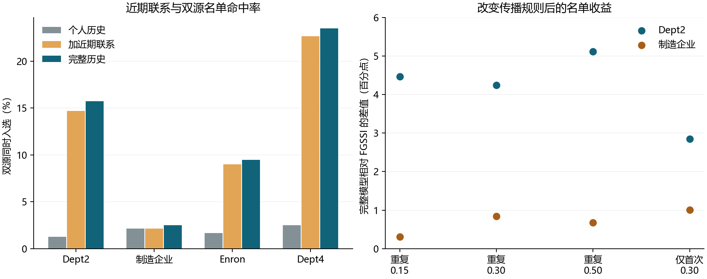
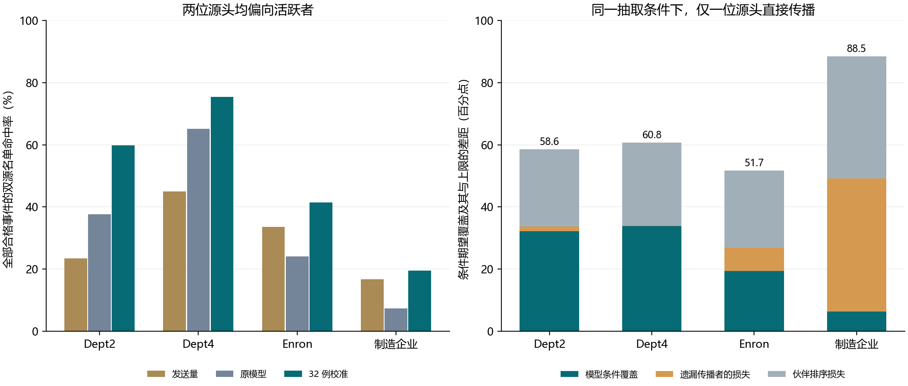

# 早期参与记录缺失时的双源定位：近期联系、源头先验与可恢复条件

> 本稿保留正文中的研究设定与实验分母。后续新增的 GNU libc 模拟、R 与 GNU libc 真实讨论、GNU libc 时间留出及 Samba 社区留出，见[实验进展与证据索引](docs/experiments.md)。

## 摘要

若最早的参与记录已经缺失，哪些证据能帮助一份有限名单同时保留两位源头？本文在真实通信时间线上模拟双源传播，只给模型窗口前的接触记录与后期成员，要求从历史名册中返回 12 人。在 Dept2 邮件网络，加入候选人和可见成员的近期联系，使双源命中率从 1.28% 升至 14.68%；在制造企业，同一改动仅使命中率从 2.15% 变为 2.17%。我们进一步控制发起者的抽取分布。在 Enron 的混合先验实验中，当每次抽取有 80% 的概率采用两人活跃度乘积作为权重时，使用相同训练样本并在无序二人组后验中显式加入先验，双源命中率由 34.05% 升至 39.75%。改为优先抽取近期有直接联系的二人组时，同一方法低于对照 2.24 个百分点。对只有一位源头直接带来新成员的事件，我们给出另一位源头的精确条件后验，并将公开名单与完整记录上限的差距分解为传播者遗漏与伙伴排序。最后，在四个真实邮件社区的 524 条讨论中检验最早两位发言者的恢复，模拟训练的模型未能稳定超过近期发帖量。结果表明，源头选择方式和历史联系的区分度共同决定了名单收益，完整记录也未必足以点名两位源头。

## 1　引言

传播源定位通常从已经出现的传播痕迹反推起点。在成员进入时间靠后的局部记录中，有一个对多源定位尤为重要的困难：一位源头足以解释许多后期成员，另一位源头甚至可能没有直接带来任何新成员。系统可以较容易地找到一个合理人选，同时几乎没有证据点名其伙伴。因此，我们将“给定固定名单预算，两位真实源头能否同时进入名单”作为主要问题，同时报告精确配对作为更严格的评价。

已有工作使用历史级联估计传播网络，并由部分观测推断源头和开始时间。多源方法还包括从感染子图寻找多个中心，以及通过图上的贝叶斯优化搜索源头集合。本文关注有时间戳的历史接触与可见后缀之间的联系，比较时固定可用观测、合法候选人和输出预算。这个设定使我们能够分别检验通信历史、源头间交互和传播规则对结果的影响。[Farajtabar 等，AISTATS 2015](https://proceedings.mlr.press/v38/farajtabar15.html) · [Zhu 等，部分感染观测下的多源定位](https://arxiv.org/abs/1611.06963) · [Zhang 等，AAAI 2024](https://arxiv.org/abs/2403.16818)

从部分观测计算源头后验已有长期研究。Altarelli 等用信念传播处理含未知节点状态或感染时刻的观测，在树上可精确求解。Brack 等在八个时序网络的单源实验中对比七种方法，发现信念传播和反向追踪网络整体表现较好。本文的预测阶段只读窗口开始前的接触记录，评价的是一份名单能否同时覆盖两位初始成员。第 5 节另提供窗口内完整接触和精确加入时刻，用来量化额外信息的价值。三类结果对应不同的观测条件和评价目标。[Altarelli 等，2014](https://arxiv.org/abs/1307.6786) · [Brack 等，2026 年预印本](https://arxiv.org/abs/2611.23175)

## 2　任务与方法

以一个 14 天窗口为单位，将窗口开始前至少联系过一次的节点构成历史名册。在名册中均匀抽取两人作为初始成员。窗口内每次有向接触只能由已加入的发送者激活尚未加入的接收者，同一时间戳中的状态同步更新。主设置为每次合格接触独立以 0.30 的概率激活。同批成员保持完整，从最早一批开始遮住约一半新加入者，保留至少有一个隐藏批次且可见成员不少于三人的事件。已知源头数为二，源头身份、窗口内通信和传播父子关系只用于模拟及评测。

把可见后缀按批次的先后压缩为至多五组，对每个未出现的历史成员计算得分。三组模型共享相同的两层编码器（宽度 40 和 24）、特征维数、名单规则和双源监督。**个人历史**使用候选人的历史收发度数、收发量和近期分时活动，并保留观测人数、候选规模等上下文。**加入近期联系**在此基础上读取四项统计，包括近 28 天候选人发往可见成员的平均联系量，以及历次两周窗口按新近程度加权后的外发均值、入向均值和入向最大值。**完整历史**进一步使用历史有向距离、按时间回放接触得到的可达性，以及早晚可见成员受到的传播支持。逐人特征同时保留在当前候选名单中的相对排名。限制输入时将对应列置零，重新训练全部网络参数。

设合法候选人为集合 $V$，模型给每人一个分数 $s_i$，给无序源头对的分数为 $s_i+s_j$。对于真实源头对 $\{a,b\}$，单事件损失为

$$
\mathcal L=\log\sum_{i<j,\ i,j\in V}\exp(s_i+s_j)-s_a-s_b.
$$

归一化遍历全部合法二人组。推理时选择分数最高的 12 人。在加性打分下，这份名单也使名单内全部候选对的总概率最大。训练在每个开发网络的 1,000 条较早事件上进行，根据后续 300 条验证事件的无序对负对数似然，从第 3、7、12 轮选择权重。五个随机种子配对复用数据顺序与初始化。比较显式交互时另设联合打分，保持观测与监督一致。[模型实现](scripts/distilled_source_pairs.py) · [限制输入的训练与复核](scripts/recent_member_evidence.py)

## 3　跨网络的候选覆盖

主指标的分母是满足遮挡规则的全部事件。数字为五个训练种子的平均百分比，同一事件重复训练五次仍只算一个测试事件。Dept2 与制造企业各使用本网络的早期样本训练，Dept4 和 Enron 使用 Dept2 权重。Dept4 在生成该批目标标签前冻结完整模型、静态模型、FGSSI 和窗口规则。Enron 已用于早期实验，当前逐人模型的比较属于事后分析。

| 网络 | 合格事件 | FGSSI | 静态历史＋逐人打分 | 完整有向时序历史＋逐人打分 |
|---|---:|---:|---:|---:|
| Dept4，同机构新部门 | 1,308 | 17.87% | 20.87% | **23.49%** |
| Enron，跨机构 | 1,560 | 6.27% | 7.01% | **9.47%** |

Dept4 预先等距选取 12 个时间窗，每窗均匀抽取 400 次，1,308 条满足遮挡要求的事件分布于其中七窗。以五个种子和相邻三个所选窗口作配对分块重采样，完整模型相对 FGSSI 的差值为 +5.61 个百分点，95% 区间为 [+4.44, +6.98]。相对相同打分形式的静态历史模型，差值为 +2.61 个百分点，区间为 [+1.66, +3.89]。Dept4 与 Dept2 来自同一欧洲研究机构。[Dept4 数据说明](https://snap.stanford.edu/data/email-Eu-core-temporal.html) · [冻结协议](runs/history_components/Dept4/protocol_lock.json) · [主表与配对区间](runs/history_components/summary.json)

## 4　哪类近期联系有辨识度

| 网络 | 个人历史 | 加入近期联系 | 完整历史 | 加入近期联系的差值 |
|---|---:|---:|---:|---:|
| Dept2 | 1.28% | 14.68% | 15.73% | +13.40 个百分点 |
| 制造企业 | 2.15% | 2.17% | 2.52% | +0.02 个百分点 |
| Enron，事后迁移 | 1.67% | 9.00% | 9.47% | +7.33 个百分点 |
| Dept4，事后迁移 | 2.49% | 22.65% | 23.49% | +20.15 个百分点 |

差值从未舍入值计算。Dept2 的五个种子均从加入近期联系中获益。在 422 条两位源头均直接引入过新成员的事件中，命中率从 3.13% 升至 32.13%；在 778 条仅一位源头直接引入过新成员的事件中，由 0.28% 升至 5.22%。制造企业这两类事件的变化方向相反，分别由 4.08% 升至 5.41% 和由 1.26% 降至 0.68%。Enron、Dept4 的简化模型直接使用本轮在 Dept2 拟合的权重，属于已知目标网络上的机制分析。[Dept2 分层结果](runs/recent_member_evidence/Dept2/summary.json) · [制造企业分层结果](runs/recent_member_evidence/company/summary.json) · [Enron 迁移](runs/recent_member_evidence/posthoc/Enron/summary.json) · [Dept4 迁移](runs/recent_member_evidence/posthoc/Dept4/summary.json)

为解释网络差异，我们逐事件检查窗口前 28 天候选人向后期可见成员发出的接触数。Dept2 中，至少有一次此类联系的真源占 52.2%，其他合法候选人占 8.6%；制造企业中分别占 67.7% 和 55.1%。按联系数区分同一事件的真源和其他候选人，平分按半次正确计算，两网的平均 AUC 分别为 0.719 和 0.556。在制造企业，与可见成员联系过的其他候选人也很多，这项证据单独支持源头身份的能力较弱。该观察反映当前接触记录、模拟规则和合格事件的共同影响。[逐事件诊断方法与汇总](runs/recent_member_evidence/contact_diagnostic_and_audit.json)

## 5　改变传播规则后的表现

固定五个训练种子的权重和历史回放参数。在两个开发网络的四个测试窗中，每窗重新抽取 200 对源头，每对在四种传播条件下共用源头、起始随机种子和真实接触序列。每种规则产生自己的后缀和合格样本。下表报告模型在该条件下全部合格事件中的结果，双源率为完整逐人模型的名单命中率，差值为与 FGSSI 的逐事件配对差。

| 接触激活规则 | Dept2 合格数 / 800 | Dept2 双源率 | 相对 FGSSI | 制造企业合格数 / 800 | 制造企业双源率 | 相对 FGSSI |
|---|---:|---:|---:|---:|---:|---:|
| 重复尝试，概率 0.15 | 224 | 14.82% | +4.46 个百分点 | 579 | 1.69% | +0.31 个百分点 |
| 重复尝试，概率 0.30 | 358 | 17.71% | +4.25 个百分点 | 668 | 2.57% | +0.84 个百分点 |
| 重复尝试，概率 0.50 | 446 | 20.72% | +5.11 个百分点 | 707 | 1.87% | +0.68 个百分点 |
| 每条有向边仅首次合格接触尝试，概率 0.30 | 246 | 13.33% | +2.85 个百分点 | 595 | 2.32% | +1.01 个百分点 |

在这八个网络与规则组合中，完整模型的平均命中率也均高于静态逐人模型。传播概率会改变哪些源头抽取能够形成足够长的可见后缀。只保留四种条件都合格的抽取后，Dept2 剩 183 对，制造企业剩 535 对，完整模型仍在两网四种条件下高于两种对照。制造企业的绝对水平和配对差值均较小，每个开发网络只有四个现实窗口。[Dept2 逐条件与共同合格分析](runs/recent_member_evidence/stress/Dept2/summary.json) · [制造企业逐条件与共同合格分析](runs/recent_member_evidence/stress/company/summary.json)

### 5.1　改变源头抽取方式

前述模拟均匀选择两位源头，真实通信中的活跃成员可能更容易在早期出现。为隔离这一影响，我们保持传播概率、真实接触序列与遮挡规则，独立抽样三类无序源头对。令 $w_i$ 为窗口前 28 天成员 $i$ 的发送次数加一。三个抽取分布对每对不同成员赋予的相对权重依次为 $1$、$w_i+w_j$ 和 $w_iw_j$。第二种等价于一位按活跃度、另一位在余下成员中均匀抽取；第三种等价于两位各自按活跃度独立抽取，并以身份不同为条件。抽取在生成传播轨迹之前完成，因此每组均报告自己的合格事件数。

若给定源头对后的传播与观测机制保持一致，贝叶斯公式允许用新旧先验之比重新加权源头对的后验概率。这里采用均匀抽取下训练的模型近似原后验。一次校正将模型的候选对权重 $\exp(s_i+s_j)$ 乘以相应的源头对先验权重，按候选人成为任一源头的边际概率生成 12 人名单。已知抽取规律时直接使用该权重；另设小样本校准，从同一抽取条件的 32 条较早合格事件中，按配对负对数似然选取均匀、单人或双人偏向的全强度或半强度校正。Dept4 与 Enron 采用 Dept2 选出的规则。该对照假定可获得来自相应条件的有标签校准事件。[标签先验变化的统计背景](https://proceedings.mlr.press/v80/lipton18a.html) · [预先固定的抽样与校准协议](runs/source_prior_shift/protocol.json)

| 两位源头均偏向活跃者 | 合格事件 | 仅按近期发送量 | 原模型 | 32 例校准后 | 已知抽取规律 |
|---|---:|---:|---:|---:|---:|
| Dept2 | 460 | 23.48% | 37.70% | 59.78% | 59.78% |
| 制造企业 | 634 | 16.72% | 7.35% | 19.53% | 19.53% |
| Dept4 | 1,041 | 45.05% | 65.21% | 75.43% | 76.91% |
| Enron | 3,207 | 33.61% | 24.12% | 41.48% | 43.25% |

在制造企业和 Enron，更换源头对的抽取规律足以使原模型落后于发送量排序。校准后相对原模型的差值在 Dept4 为 +10.22 个百分点（95% 区间 [+6.06, +16.27]），在 Enron 为 +17.36 个百分点（[+12.14, +22.50]）。若只让一位源头偏向活跃成员，两网的原模型和校准模型分别为 33.79% 与 35.66%、10.32% 与 13.38%。对真正均匀的源头抽取，若直接套用双人活跃度校正而跳过校准，Enron 从 7.73% 降至 6.52%。这些对照说明活动先验能改变方法排序，校正强度应取决于源头选择条件。本文未观测真实发起概率，真实讨论中的反转也可能涉及回帖角色、信息公开程度与名单覆盖。上述模拟结果仅检验一种可能解释。[四网逐条件结果、损失和配对区间](runs/source_prior_shift/results.json) · [轨迹与概率核验](runs/source_prior_shift/verification.json)

### 5.2　只看到一位源头传播时的识别上限

在一条完整模拟轨迹中，若一个地址出现在成功传播者名单上，却从未作为新成员加入，那么它必然在初始时就在场。若只有一位这样的地址 $a$，另一位源头只能是整条轨迹中未加入、也从未成功引入新成员的地址 $b$。令 $H_b$ 表示把 $b$ 放入初始集合后新增的合格外发尝试数，$B_b$ 表示因它已经在场而被取消的入向尝试数。在重复接触、固定激活概率 $p$ 的模拟器中，给定全部接触和成功父节点，伙伴的条件概率满足

$$
P(b\mid T,a)\ \propto\ \pi(a,b)(1-p)^{H_b-B_b}.
$$

这里 $T$ 包含完整加入时刻和所有成功父节点，$\pi(a,b)$ 为源头对在传播前的抽取概率。给定 $T$，兼容候选的成功尝试完全相同。候选身份只会改变失败尝试数，其相对变化恰为 $H_b-B_b$，故对先验乘以上式中的相对似然即可归一化。记最大的 11 项伙伴后验质量之和为 $U(T)$，则获得完整轨迹的最优 12 人名单由 $a$ 和这 11 位候选人组成。对只读后缀的模型名单 $L$，其条件期望命中为 $Q(L,T)=\mathbf{1}_{a\in L}\sum_{b\in L}P(b\mid T,a)$。逐事件计算后再取平均，可以把 $U-Q$ 拆为两类损失：遗漏已知传播源时损失全部 $U$；已保留它时，损失来自伙伴排序。这个上限利用了预测时不可见的信息，约束的是期望覆盖率。

在 Enron 仅一位源头直接传播的事件中，从均匀抽取变为两位均偏向活跃成员时，平均上限由 14.22%（778 例）变为 51.73%（1,102 例），两个条件各有自己的合格人群。后一条件下，32 例校准模型的条件期望命中为 19.36%；与上限的差距中，遗漏传播源占 7.46 个百分点，选错伙伴占 24.90 个百分点。Dept4 在同一条件下的上限为 60.77%，模型为 33.88%，两项损失分别为 0.21 和 26.68 个百分点。制造企业对应上限为 88.51%，模型为 6.33%，两项损失均较大（42.88 和 39.30 个百分点）。因此，活跃度先验能显著缩小沉默伙伴的可能范围，但模型能利用多少，还取决于后期观测能否指向实际传播者及其伙伴。[条件概率与逐例分解实现](scripts/prior_partner_ceiling.py) · [Enron 上限](runs/source_prior_shift/Enron/ceiling/summary.json) · [Dept4 上限](runs/source_prior_shift/Dept4/ceiling/summary.json) · [制造企业上限](runs/source_prior_shift/company/ceiling/summary.json)

### 5.3　仅凭可见后缀能否判断应采用哪种先验

32 例有标签校准需要知道较早事件的两位真实源头。为检验这一要求的影响，我们生成与上节独立的模拟批次。每个时间窗先尝试生成 120 条校准事件，从合格事件中最多取 32 个公开后缀，随后另作 180 次独立抽取用于评价。估计器只看到校准批次的后缀。它在均匀、单人活跃度偏向、双人活跃度偏向三个源头分布之间估计混合权重。对于一个公开后缀，原模型后验下的先验比期望给出各分量相对于均匀抽取的近似证据比。由于校准批次只包含遮挡后仍合格的事件，使用之前最多四个完整窗口的独立模拟估计各分量的合格率，再通过混合模型的 EM 迭代估计抽取前权重。固定对照为三个分量各占三分之一。全部评测包含四个网络、四种生成条件和 16,337 条合格事件；其中一组专门让有近期联系的候选对更常被抽取，以检查真实规律超出三分量模型时的表现。[盲估计协议](runs/blind_source_prior/protocol.json) · [逐窗权重、命中与配对区间](runs/blind_source_prior/summary.json)

当真实抽取由 5% 均匀、15% 单人偏向和 80% 双人偏向组成时，Dept4 的盲估计相对固定混合由 64.71% 升至 65.74%，差值为 +1.03 个百分点，95% 区间 [+0.25, +2.08]。Enron 上由 37.35% 降至 32.94%，差值为 −4.41 个百分点，区间 [−8.91, −1.17]。该条件下，两网按测试事件数加权的双人偏向估计权重分别为 0.84 和 0.38。若真实分量恰好等权，Enron 的盲估计也比固定混合低 2.94 个百分点。后缀中包含活动先验的信息，但依靠已有模型把这些信息换算成源头抽取概率，仍有明显的跨网误差。

为了定位 Enron 上的误差，我们在相同测试事件上只改变估计混合比例时可用的信息，预测名单仍只使用公开后缀。在 80% 双人偏向条件下，用当期完整接触流的独立模拟替代过去窗口来估算合格率，命中率由 32.94% 变为 33.11%。若进一步提供校准批次的完整成功父节点轨迹，以第 5.2 节伙伴后验计算精确证据比，测试命中率为 37.70%；直接给出这批校准事件的源头身份时为 37.72%。这些额外信息只用于诊断。在此条件下，更新合格率单独带来的变化较小，公开后缀及模型对其证据比的近似更值得关注。[校准信息对照](runs/blind_source_prior/Enron/privileged_diagnostic/summary.json)

### 5.4　先验未知时，一份名单能保留多少后验质量

设 $h_i=\exp(s_i)$，$w_i$ 为窗口前 28 天发送量加一。均匀、单人偏向和双人偏向三种先验对应的未归一化二人组质量依次为 $h_i h_j$、$h_i h_j(w_i+w_j)$ 和 $h_i h_j w_i w_j$。令 $F_r(L)$ 为第 $r$ 种条件下名单 $L$ 内全部无序对的质量。第一和第三种条件的最优名单可按 $h_i$ 或 $h_iw_i$ 直接选取。对于中间条件，将每位候选人与其最强的 11 个伙伴的边权相加，再将最大的 12 项相加除以二，得到最优名单质量的上界。记三项最优值或上界为 $B_r$。对任意非负混合权重 $\lambda$，都有

$$
\frac{\sum_r\lambda_r F_r(L)}{\max_{|S|=12}\sum_r\lambda_r F_r(S)}
\;\ge\;\min_r\frac{F_r(L)}{B_r}.
$$

原因是分子至少为右端乘以 $\sum_r\lambda_r B_r$，分母至多为该和。这个下界逐份名单成立，只针对所设模型的后验质量。固定混合与最大化下界两种方法从相同的四份初始名单出发，反复用一次换人改进各自目标。若有至少 12 名成员在 $h$ 和 $hw$ 两项均优于某候选，则在任意含该候选的名单中，总能找到一名尚未入选的成员替换它，使三项质量同时保持或增加。按此规则减少搜索规模；相等时按固定顺序打破并列。

在重新抽取的 10,854 条合格事件上，Enron 的 80% 双人偏向条件包含 2,254 条。固定混合名单与最大化下界的名单，其相对覆盖下界中位数由 76.8% 提高到 89.0%，实际双人命中率却从 38.38% 降至 35.32%，配对差值的 95% 区间为 [−4.70, −1.45] 个百分点。均匀抽取时，Enron 的实际命中率由 7.52% 变为 8.08%，区间包含零。该目标可用于表达对先验选择的敏感程度；从这些结果尚不能推出它能普遍提高实际识别率。[冻结协议](runs/robust_source_list/protocol.json) · [四网结果](runs/robust_source_list/summary.json) · [穷举与独立复核](runs/robust_source_list/verification.json)

### 5.5　完整记录中，传播父节点额外提供多少信息

为拆分第 5.2 节上限的信息来源，我们固定同样的 12,280 条轨迹，给出窗口内所有有向接触，以及每位后加入者的身份与精确加入时刻，只遮住成功父节点。对每个假设源头对，按时间推进。若某成员在一个时间批次开始时尚未加入，有 $m$ 次来自已加入者的接触，则在该批次加入的概率为 $1-(1-p)^m$，仍未加入的概率为 $(1-p)^m$。同批次的加入者从下一批次开始传播。对观测取似然并乘以已知源头先验，即可得到全部兼容源头对的精确后验。

求最优名单时，选取一例无法由更早加入者解释的激活，其可能发送者构成集合 $C$。至少一位源头属于 $C$，所以每条具有正后验权重的候选对都至少有一端落在 $C$。固定名单与 $C$ 的交集后，只需按与交集相连的总权重选择其余成员，即可准确求得最优名单。在这四个网络中，每条合格轨迹都至少包含一次只有一名可能初始发送者的激活，因而每次均找到单成员的 $C$。

我们用含父节点的完整后验重新评价两份最优名单，以同一信息条件计算额外父节点记录对决策的价值。在 12,280 条事件中，仅制造企业的 3 条出现超过 $10^{-9}$ 的条件覆盖差异。在该企业的均匀抽取条件，按全部 515 条事件取平均，补充父节点增加 0.0102 个百分点。其余网络在所报精度下均为零。这里已经提供通常不可获得的完整接触流和精确加入时刻；二者能排除大量不可能的源头对。结论只适用于上述时间粒度与名单预算，更粗的接触或加入记录可能保留多名潜在发送者。[精确后验与名单求解](scripts/activation_time_ceiling.py) · [独立接触回放与小图穷举](runs/activation_time_ceiling/verification.json)

### 5.6　与见过混合源头分布的模型比较

在训练数据中加入活跃源头，本身就可能提高测试表现。为估计显式先验的额外作用，我们在每个开发网络上分别取 1,000 条训练事件和 300 条较晚的验证事件。主对照的两个模型看到完全相同的混合训练样本，均不知道哪种规则生成了单条事件。直接训练模型令候选对质量正比于 $h_i h_j$；显式模型在训练和预测时均乘以同一个窗口内的已知等权混合先验比，再对所有合法无序候选对归一化。三个分量分别用完整历史名册上该分量的平均二人组权重归一化，因此“等权”指抽取事件之前的分量比例。两个模型共享特征、结构、验证事件、优化器、训练种子和 12 人输出预算，测试时均无目标网络标签。另设两项对照，一项只在均匀源头上训练，部署时乘以相同的等权混合先验比；另一项允许模型在训练时获知模拟器为每条事件抽中的分量。

| 测试网络与源头抽取条件 | 合格事件 | 混合样本直接训练 | 混合样本训练并显式加入先验 | 均匀训练、预测时校正 |
|---|---:|---:|---:|---:|
| Enron，三个分量等权 | 2,016 | 23.73% | **26.74%** | 26.44% |
| Enron，双人活跃度偏向占 80% | 2,607 | 34.05% | **39.75%** | 38.93% |
| Enron，均匀抽取 | 1,027 | **8.57%** | 7.89% | 7.36% |
| Enron，近期有直接联系的二人组更常入选 | 1,267 | **19.56%** | 17.32% | 17.93% |
| Dept4，双人活跃度偏向占 80% | 865 | 65.64% | **66.01%** | 65.32% |

四网重新抽取 25,760 次，得到 12,805 条合格事件。与混合样本直接训练相比，显式模型在 Enron 的等权条件下提高 3.01 个百分点，95% 配对区间为 [+0.97, +5.45]；双人活跃度偏向占 80% 时提高 5.70 个百分点，[+2.88, +9.39]。但后一条件下，它相对于均匀训练、预测时校正只提高 0.83 个百分点，[−0.65, +2.39]。当模拟器改为偏向近期有直接联系的二人组、超出上述三种分量的混合范围时，显式模型落后直接训练 2.24 个百分点，[−3.31, −1.02]。Dept4 的 80% 条件差值为 +0.37 个百分点，[−1.41, +2.06]。Enron 的正向结果支持在这些抽取条件下把先验写入预测；相对简单校正，增加混合样本重训的收益尚未得到确认。此次抽取使用新的随机流，通信网络和评测时段与前述实验相同。[训练与评测协议](runs/trained_source_mixtures/protocol.json) · [四网命中、配对区间和对数损失](runs/trained_source_mixtures/summary.json) · [归一化与梯度对照](runs/trained_source_mixtures/verification.json)

## 6　双源名单与精确点名

名单命中允许在 12 人中保留多个可能的源头对。按所有合法无序二人组排名时，显式交互在 Dept2 将真实对进入前 32 的比例从 9.50% 提高到 13.63%，七个补充窗从 13.33% 提高到 16.95%。Enron 上同一改动使该指标从 5.97% 变为 5.05%。在较大名册的 CollegeMsg，单种子交互模型在 480 个事件中至少找回一位源头 52 次，同时找回两位为 0 次。后期可见成员和实际源头之间可能缺乏可区分的历史联系，名单收益因而需要与精确配对能力分别解释。[组合排名与候选池诊断](runs/factorial_history/四组消融与五种子验证.md)

为与直接搜索无序源头集合的方法对照，我们将后缀合并为一张单快照。Dept2 和制造企业的四个主测试窗口各按公开事件编号的固定哈希抽取 25 例，每个网络共 100 例。双方接收同一历史记录和同一可见成员集合，并在全体未出现的成员中返回一对候选。学习模型采用专门训练的单快照组合模型，训练时可使用历史训练轨迹产生的条件后验。BOSouL 适配使用作者的图傅里叶变换、K-means 分层初始化以及基于期望改进的搜索循环。原实现的 SI 分支从已感染成员中提名源头，本任务的源头被前缀遮挡，故将搜索范围改成全部合法候选。评价一对候选时，在窗口之前的联系序列上模拟传播并施加同一遮挡规则，以模拟后缀和观测后缀的 Jaccard 相似度作为目标，无合格后缀记零。高斯过程使用兼容版本的 BoTorch 接口。[BOSouL 作者实现](https://github.com/XGraph-Team/BOSouL/tree/e891f84f8d5e1c829b511672da7d946aeba06def) · [适配与预算](scripts/masked_bosoul.py)

在每事件 20 次初始化、10 次搜索迭代、每次评价 10 次模拟的预算下，两种方法在每个网络的 100 例中精确命中均为 0。若考查所报两人中至少一人正确，Dept2 为学习模型 25 例、BOSouL 适配 9 例，制造企业均为 3 例。两网合计 60,000 次传播模拟。开发窗口的这个预算受限比较尚不足以区分两种方法的精确点名能力。运行中出现过高斯过程优化器的收敛警告，全部事件均返回合法预测。原论文的完整感染快照和原始评测成绩不在此表中。[Dept2 单快照记录](runs/recent_member_evidence/single_snapshot/Dept2/summary.json) · [制造企业单快照记录](runs/recent_member_evidence/single_snapshot/company/summary.json)

## 7　真实讨论中最早两位发言者的迁移检验

模拟器为每个事件指定两位同时存在的源头。在公开邮件讨论中，能够直接核对的事实是哪个地址发表了根邮件、哪个不同地址最早随后发言。两者对应不同角色，早期回帖者可能由首发者吸引加入。为检验名单方法对真实早期参与身份的外推能力，我们使用 Python-Dev 和 Python-Ideas 的公开邮件头，沿回复指针重建讨论树，以首封邮件和其后 14 天内各地址首次发言的时间生成记录。每个地址作为一个身份，同一人使用多个地址可能造成拆分。有回复标记但无法确认根节点的链不进入测试。较短的讨论、可见参与者较少的事件和从未建立回复关系的新成员限制了这项检验的覆盖面。[Python-Dev 官方归档](https://mail.python.org/pipermail/python-dev/) · [Python-Ideas 官方归档](https://mail.python.org/pipermail/python-ideas/)

选取 2017 至 2018 年开始的讨论，移除最早两个不同发言地址，再对其余新参与者按原规则遮挡早期约一半，保留至少三个后期可见成员。历史图只用讨论开始月份之前 98 天的直接回复，边从回帖作者指向被回复邮件的作者，名单预算仍为 12 人。将可见成员投影到历史名册后，若剩余不足三人，全部方法都记作未命中。真实早期发言者不在名册中也保留在分母。两个列表属于同一技术社区，分别报告。以下各模型采用在 Dept2 模拟数据训练的既有权重，近期发帖量对照直接按过去 28 天的邮件数排序。[事先冻结的代码与权重](runs/public_thread_transfer/protocol.json)

| 邮件列表 | 可核对的讨论根 | 满足遮挡规则 | 可实际打分 | 按近期发帖量排序 | 个人历史＋近期联系 | 完整时序模型 | FGSSI |
|---|---:|---:|---:|---:|---:|---:|---:|
| Python-Dev | 936 | 174 | 146 | **14.37%** | 5.86% | 8.28% | 10.46% |
| Python-Ideas | 636 | 243 | 219 | 7.00% | 3.46% | 6.26% | 7.08% |

近期联系模型相对近期发帖量的主要配对差值，在 Python-Dev 为 −8.51 个百分点，在 Python-Ideas 为 −3.54 个百分点。对训练种子和连续三个月份同时重采样，95% 区间分别为 [−11.96, −5.25] 和 [−5.80, −1.31]。两个列表中，各有 108 条讨论既能打分、又满足两名早期发言者都在候选名册内。只考查这些讨论，按发帖量排序的双人命中率分别为 23.15% 和 15.74%，近期联系模型分别为 9.44% 和 7.78%。因此，这一差距在排除名册覆盖限制后仍然存在。按发帖量排序，对首发者和第二位发言者的单人成绩分别为 Python-Dev 29.89% 和 44.25%、Python-Ideas 13.17% 和 36.63%。在这两份公开讨论记录中，近期活跃度对找回早期回帖者尤其有用。[逐角色、逐月及配对结果](runs/public_thread_transfer/summary.json)

为检验直接迁移的差距在真实数据校准后是否缩小，我们合并两个列表中可打分且两位早期发言者均在名册内的历史讨论，取 2017 年至 2018 年 6 月的 172 条训练，之后六个月的 44 条选择正则强度。逐人线性模型使用最近 28 天、98 天的发帖次数，扩展模型再加入过去 28 天向可见成员回复和收到可见成员回复的次数，各项先取 $\log(1+x)$，训练目标为无序真实地址对的负对数似然。在读取后续月份归档之前固定系数，以 2019 年 1 月为间隔，测试 2 至 4 月的全部合格讨论。在 Python-Dev，发帖量、校准活跃度模型、再加入联系人模型三者均命中同一批 5/24 条讨论。在 Python-Ideas，三者分别为 2/27、1/27、1/27。后续期只有 51 条讨论；加入联系的模型相对发帖量没有新增命中，少命中 1 条。主要比较统一了最低后缀要求。允许无需后缀的发帖量基线始终输出名单时，它在前两年分别命中 28/174 和 18/243 条，高于统一条件下的 25/174 和 17/243 条。[后续月份参数锁](runs/public_thread_transfer/calendar_followup/lock.json) · [逐月命中结果](runs/public_thread_transfer/calendar_followup/summary.json) · [独立复算](runs/public_thread_transfer/calendar_followup/audit.json)

### 7.1　两个新社区的角色与讨论历史

上一项试验中，近期发帖量对首发者和第二位发言者表现不同。进一步为两个角色分别学习概率，使用最近 28 天和 98 天的发帖量，以及在过去已结束的 14 天观测段中担任首发者和第二位发言者的次数。在此基础上分别加入对当前可见成员的收发回复次数、与当前可见成员重合的历史讨论给两个角色的投票。历史讨论以成员集合的逆文档频率加权余弦相似度平方计票，只使用起点位于当前月份之前 98 至 14 天内的讨论及其前 14 天的发言。每个角色使用已知且在名册内的该角色标签拟合条件概率。输出名单时，将二者的分布以地址不同为条件组合，在 12 人预算下以贪心插入与单人替换寻找覆盖概率较大的名单。

模型只用 Python 社区 2017 年 1 月至 2018 年 5 月的数据拟合，间隔一个月，再用 2018 年下半年选择正则强度。随后锁定模型，在 GCC 与 FFmpeg 两个不同社区 2021 至 2022 年的讨论中评测。GCC 的 1,510 个可核对根中，32 条达到遮挡要求，17 条可打分，仅 5 条同时满足可打分且两人均在名册内。发帖量基线命中 0 条，角色模型命中 1 条。FFmpeg 的 5,014 个根中，24 条达到遮挡要求，21 条可打分，13 条同时可达；发帖量基线与角色模型均命中 9 条。两个项目中，加入历史讨论检索相对已有角色和直接联系特征的模型均未改变任何一例的双人命中判断。可用于检验长后缀的真实讨论有限，结果尚不能支持这一检索策略在新社区带来额外收益。[GCC 邮件归档](https://gcc.gnu.org/pipermail/gcc/) · [FFmpeg 开发列表](https://ffmpeg.org/pipermail/ffmpeg-devel/) · [训练与跨社区协议](runs/historical_thread_roles/protocol.json) · [逐月结果和名单复核](runs/historical_thread_roles/summary.json)

另一种限制来自名单本身。取消“至少三名后期发言者已在名册内”的打分门槛，并允许使用月初之前曾发过帖的所有地址，Python-Dev、Python-Ideas、GCC 和 FFmpeg 中两位早期作者理论上均可入选的讨论数，分别从 108、108、5、13 增至 146、137、19、19。按相同预算和月初最近 28 天的发帖量实际排序，命中数仅由 25、17、0、9 变为 28、18、0、10。更大的历史名册显著提高“有可能找回”的事件数，但它同时增加了参与排序的候选人。分别扩大名册、更新统计截止时刻以及使用隐藏根邮件的真实起点作诊断，可区分这两种变化。真实起点只属于信息上限对照。[候选名单分母与实际命中](runs/real_roster_ceiling/summary.json)

我们也把第 5.6 节在 Dept2 上训练的四组模型直接用于上述真实讨论。先验输入为最近 28 天发出的可解析回复数加一，发帖量基线仍统计所有帖子。重新构造的真实讨论、早期身份、可打分条件以及基线名单与既有归档逐条相符。四个社区的三个时间段合计 524 条合格讨论。2017 至 2018 年，Python-Dev 中混合样本直接训练和显式模型的五种子平均双人命中数分别为 16.6、20.6，发帖量基线为 25（分母 174）；Python-Ideas 分别为 15.8、16.4 和 17（分母 243）。2019 年后续期，两列表的显式模型分别为 3.4/24 和 1.0/27，发帖量基线为 5/24 和 2/27。在 GCC 和 FFmpeg，显式模型分别为 0.2/32 和 8.4/24，基线为 0/32 和 9/24。模拟训练能缩小部分差距，但这些真实结果尚不足以支持它稳定优于近期发帖量。[真实迁移设置](runs/trained_source_mixtures/early_speakers/protocol.json) · [分社区及逐种子命中](runs/trained_source_mixtures/early_speakers/summary.json)

## 8　结论与适用范围

给定同样的后期可见成员，历史联系何时有用，取决于多少其他候选人也留下相同线索。在 Dept2、Dept4 和 Enron，四项近期联系统计能复现个人历史与完整模型之间的大部分差距；制造企业中这组特征的贡献接近零。即便保持通信流和传播规则一致，只让发起者更常来自活跃成员，也足以反转方法与发信量基线的排序。32 条已知源头的同条件模拟事件可帮助选择校正强度；只凭公开后缀估计这一强度，在 Dept4 与 Enron 出现了方向相反的结果。

模型提升与信息上限也可以分别量化。即使给出完整传播轨迹，均匀先验下沉默伙伴仍可能对应许多相容身份；而对已有精确接触和加入时间的观察者，额外告知成功传播者很少改变最优 12 人名单。在四个真实邮件社区，对首发者和第二位发言者的实验只支持有限的跨社区迁移。真实共同发起者的身份、未知源头先验的可靠估计，以及粗时间记录下的可恢复程度，仍需独立证据。

完整的抽样分母、旧方法、逐窗结果和复现说明见[实验底稿](论文实验结果与写作底稿.md)。
